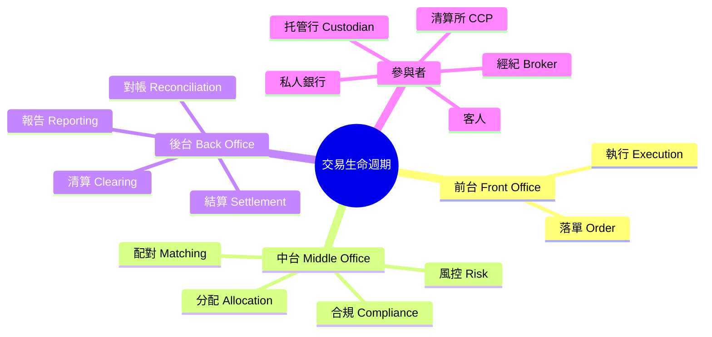
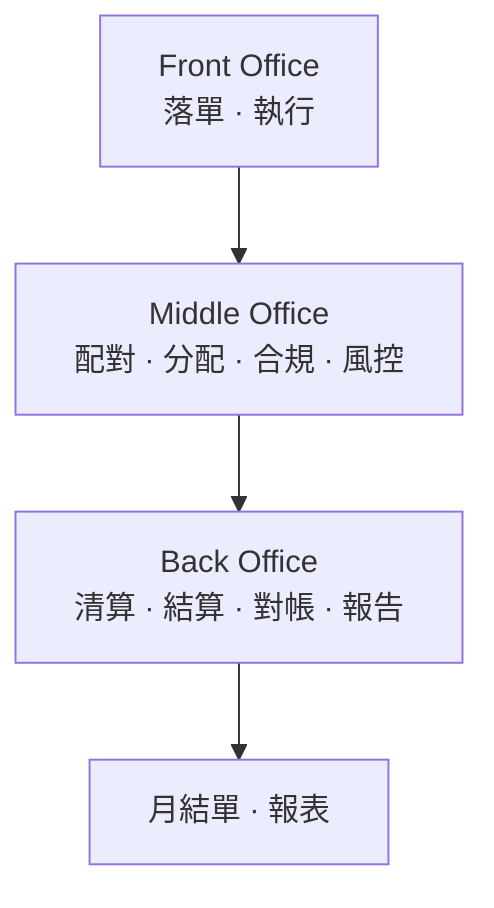
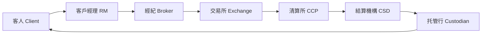

# Module 01: 交易生命週期總覽

Est. study time: 1h
Language: yue
Description: 由客人落單到收貨入帳，成條鏈係點運作；front/middle/back office 分工；邊個負責邊個環節

## Knowledge Map

---

## Learning Objectives
- 用一條完整故事講出由落單到入帳嘅每個步驟
- 分辨 front、middle、back office 各自負責乜
- 講出生命週期入面每個參與者嘅角色

---

## Real-World Example

陳生喺私人銀行開咗個投資戶口。朝早 10:00，佢同客戶經理講：「幫我買 10,000 股匯豐，上限 $65 股價。」下晝 3:30，佢收到手機通知：「已成交 10,000 股 @ $64.5」，跟手收到 fill report 確認成交。兩個工作日後（T+2），股票先正式入佢戶口，扣咗 $645,000 股價 + $968 佣金 + $645 印花稅。月尾打開月結單，先見到呢筆交易嘅完整記錄。

由陳生開口到月結單出街，中間發生咗成條「交易生命週期」。呢條鏈有 6 個主要環節：**落單 → 執行 → 配對 → 分配 → 清算 → 結算**。今次呢條課就係將呢條鏈逐截拆開。

> **Think**: 陳生覺得「買股票咪就係俾錢攞貨咁簡單」，點解中間要咁多步驟？
>
> *Answer: 因為唔係陳生同埋「市場」直接交易。佢條單要經過經紀、交易所、清算所、托管行先至真正過戶。每一步都要確保「錢啱、貨啱、份數啱」，唔係嘅話隨時錢貨兩失。*

---

## Core Content

### Section 1: 生命週期六步曲

一條交易由生到死，大致經過呢六步：

**Step 1 落單 Order** — 客人（或者客人嘅經理）決定買賣，張單入咗系統。呢一刻你只係「想買」，市場仲未有人理你。

**Step 2 執行 Execution** — 張單送去交易所或者做市商度，搵人同你成交。有啲即刻成交，有啲等緊價位。

**Step 3 配對 Matching** — 買賣雙方嘅資料要「對得上」：你買 10,000 股，有人賣 10,000 股，價位一致，先至算一張真正嘅成交 trade。

**Step 4 分配 Allocation** — 如果張單係成組客人合買（例如基金經理幫 50 個客一齊買），要將成交咗嘅貨，按比例分翻俾每位客人。

**Step 5 清算 Clearing** — 清算所（CCP）出面做「保證人」：就算其中一方突然唔認數，佢都會保證交收。同時將多張對沖交易互相抵消（netting），減少實際要過手嘅錢。

**Step 6 結算 Settlement** — 錢貨兩訖嘅一刻。你嘅錢由戶口過出，股票過入你戶口。香港股票而家係 T+2（2 個工作天內完成）。

> **Think**: 點解「配對」要排喺「清算」之前？調轉得唔得？
>
> *Answer: 唔得。配對係「確認呢張成交真係存在」（價、量、日期對得上）；清算係「對已確認嘅成交做保證同 netting」。未確認成交係咪真就去清算，等於處理一張可能唔存在嘅交易。*

> **Cloze**: "一條交易生命週期嘅六個主要步驟係 {落單}、{執行}、{配對}、{分配}、{清算} 同 {結算}。"
>
> *Answer: 落單、執行、配對、分配、清算、結算*

### Section 2: Front / Middle / Back Office

成條鏈唔係一個人做晒，係三個部門接力：

| 部門 | 負責環節 | 一句講法 |
|---|---|---|
| Front Office 前台 | 落單、執行 | 「搵食」部門，直接接觸客人同市場 |
| Middle Office 中台 | 配對、分配、合規、風控 | 「監工」，確保前台冇亂嚟 |
| Back Office 後台 | 清算、結算、對帳、報告 | 「執手尾」，確保錢貨兩訖 |

**常見誤會**：私人銀行嘅客戶經理（RM）屬於 Front Office。佢幫客人落單，但佢唔會自己幫客人「對數」或者「過戶」——嗰啲係 Middle/Back Office 嘅工作。

> **Think**: 你自己喺 App 買股票，好似全部嘢一個 App 搞掂。其實係咪真係冇 Middle/Back Office？
>
> *Answer: 絕對有。你見到嘅只係「落單」同「成交」兩個畫面。你 App 背後，券商、交易所、清算所、托管行全部照走。你冇見到，唔代表冇發生。*

> **Predict**: 如果 Back Office 罷工一日，你覺得今日買嘅股票，最實際會出咩問題？
>
> *Answer: 最實際係交收停——BO 負責入帳同交收指令，罷工就冇人遞指令 → settlement fail。賣家收唔到錢、買家收唔到貨，倉位停喺 pending。月結單冇數只係報表層小事。但你知買咗乜：OMS 顯示 Filled，T+0 fill report、contract note 照有；配對分配係 Middle Office，都可能做咗。Front Office 罷工先係落唔到單。*

### Section 3: 參與者一覽

一條交易最少涉及呢幾方：

| 參與者 | 做乜 |
|---|---|
| 客人 Client | 出資嗰個，最終承擔盈虧 |
| 客戶經理 RM | 代表客人落單，私人銀行前台 |
| 經紀 Broker | 將張單送入市場，收佣金 |
| 交易所 Exchange | 提供撮合場地，保證公平 |
| 清算所 CCP | 做交易對手嘅保證人，降低對手風險 |
| 結算機構 CSD | 記錄邊個揸住邊隻股票（中央登記） |
| 托管行 Custodian | 實際保管股票同現金 |

> **Think**: 點解要有清算所（CCP）？直接買賣雙方交收唔係更省事？
>
> *Answer: 直接交易嘅話，你要信「對方會找數」。萬一對方破產，你損失慘重。清算所做你同市場嘅「中間人」——你嘅對手變成清算所，信用級別高得多。代價係你要交保證金（margin），但換嚟嘅係唔使驚對方跳單。*

> **Spot the Mistake**: 有新手以為「私人銀行幫我買股票，其實係私人銀行自己賣俾我」，所以覺得銀行一定睇住佢賺錢先肯做。
>
> 邊度錯？
>
> *Answer: 混淆咗「中介」同「交易對手」。多數情況下，私人銀行只係幫你執行（agency），佢收佣金，唔係同你對賭（principal）。銀行嘅角色係「搵到好價位俾你」，唔係「同你開盤口」。只有銀行以自營身份交易時，先至係對手盤。*

---

## Why This Matters

明白生命週期，你先至睇得明月結單上每一個數目點解喺嗰度。佣金幾時扣、股票幾時入戶、點解有時「成交咗但未入帳」——全部都係呢條鏈嘅產物。當你識得問「呢個環節出咗事？」，你已經識得自己搵答案，唔使等人答你。

---

## Key Takeaways
- 生命週期六步：落單 → 執行 → 配對 → 分配 → 清算 → 結算
- Front Office 搵食、Middle Office 監工、Back Office 執手尾
- 參與者：客人 → RM → 經紀 → 交易所 → 清算所 → 結算機構 → 托管行
- 清算所做保證人，將對手風險由「你」轉移去「CCP」
- 你 App 見到嘅「成交」，只係成條鏈嘅第一截

---

## Common Misconception

**「成交咗就等於入咗帳。」**

錯。成交（execution）只係話「有人同你搵到對手」，真正入帳（settlement）係之後嘅事。香港股票 T+2，即係你今日成交，最快後日先至真正過戶。中間任何一環出事（配對唔上、清算失敗、托管行有問題），你都會「成交咗但未入帳」。

---

## Spot the Mistake

你今日買咗隻股票，App 即刻顯示「成交」，你即刻開月結單想睇吓，發現月結單上面乜都冇。你打去客服投訴：「我明明買咗，你哋食咗我啲貨！」

邊度錯？

*Answer: 月結單係 Back Office 對完帳先出嘅報告，通常月尾或者月頭先有。你即日成交，即日梗係冇。另外，T+2 未過，股票仲未正式入你戶口。你應該睇「成交確認」（contract note）或者「倉位」頁面，唔係月結單。*

---

## Feynman Explain

(試下用「外賣」做類比解釋成條生命週期。提示：你落單 → 店家接單 → 外賣平台撮合 → 平台分派 → 店家準備 → 送達 → 你俾錢收貨。講吓邊個環節對應落單、執行、配對、分配、清算、結算。)

---

## Reframe

(諗吓：如果你係私人銀行 RM，客人投訴「我琴日買咗股票，點解今日仲未見到入帳」，你會點同佢解釋？試下用今次學到嘅六步曲，寫 3 句說話俾客人聽。)

---

## Drill
Take the quiz. MCQs test recall + application + scenario.

Run: `learn.sh quiz trade-lifecycle 01-lifecycle-overview`
Run: `learn.sh cloze trade-lifecycle 01-lifecycle-overview`
