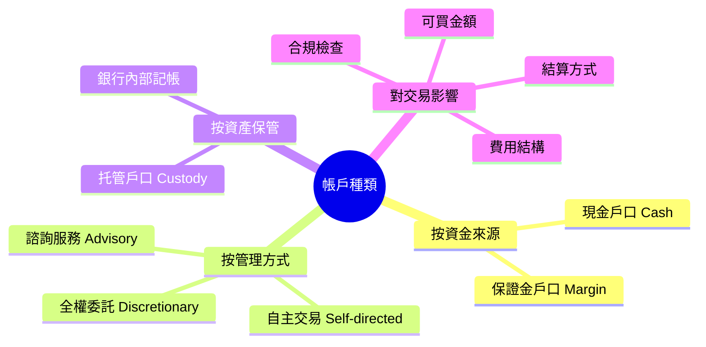
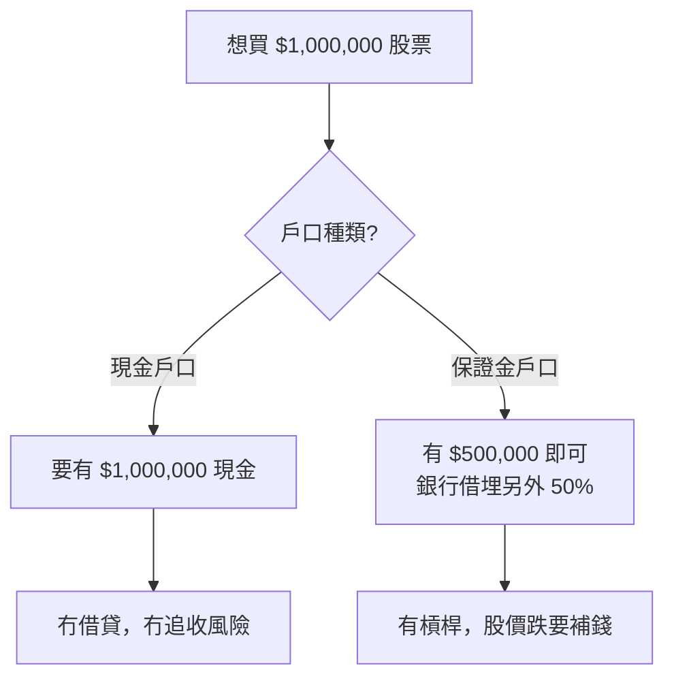
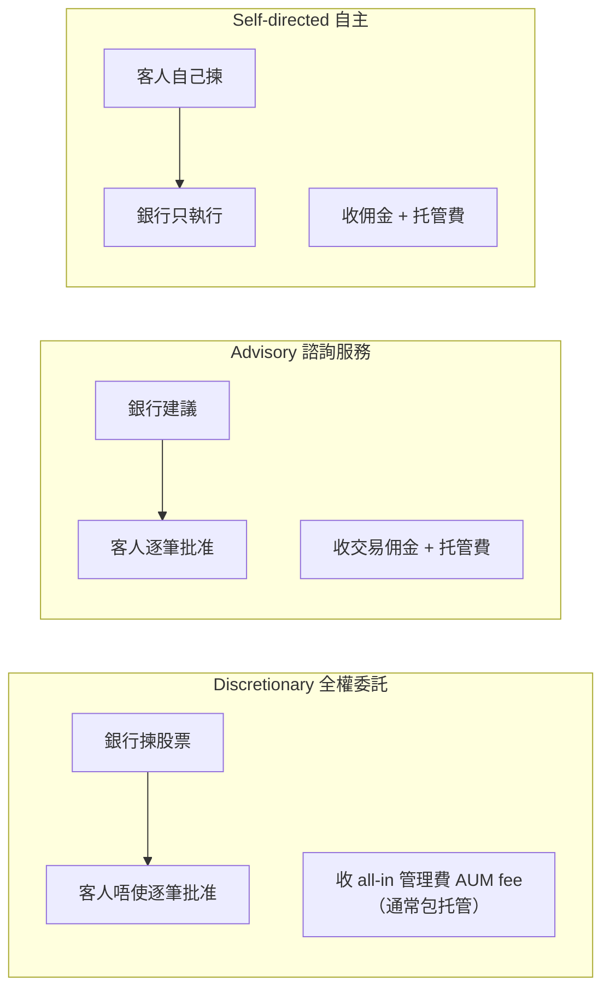
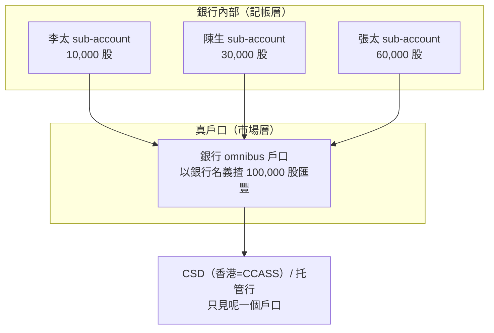

# Module 02: 帳戶種類點樣影響交易

Est. study time: 1h
Language: yue
Description: custody/cash/margin 戶口分別、discretionary vs advisory、私人銀行複合戶口點樣影響落單、結算同費用

## Knowledge Map

---

## Learning Objectives
- 分辨現金戶口同保證金戶口嘅交易差異
- 比較全權委託同諮詢服務嘅落單方式
- 解釋帳戶種類點樣影響結算、費用同合規檢查

---

## Real-World Example

李太喺私人銀行開咗兩個戶口：一個「保證金戶口」，一個「全權委託戶口」。

保證金戶口入面有 $500,000 現金。佢想買 $1,000,000 嘅股票，經理同佢講：「得，你可以買——自己攞 $500,000，銀行借埋另外 $500,000。」但全權委託戶口就唔同——銀行根據佢嘅「投資目標」自動幫佢揀股票，李太自己唔可以指定「我要買匯豐」。

同一個人，兩個戶口，買嘢嘅方式、邊個話事、收咩費用全部唔同。**帳戶唔係「擺錢嘅地方」，係「規則嘅容器」**。

> **Think**: 點解私人銀行要將李太嘅資產分開兩個戶口，而唔係擺晒入一個？
>
> *Answer: 因為兩個戶口嘅「規則」唔同。保證金戶口可以借孖展、客人自主下單；全權委託戶口銀行代客決策、收 all-in 管理費（通常包托管）。混埋一齊嘅話，邊啲錢可以借、邊啲交易邊個話事，全部講唔清。*

> **Cloze**: 現金戶口 = 全額 {現金}；保證金購買力 = 持倉 × {保證金}比例；複合戶口內部 {記帳} 分邊個揸幾多。
>
> *Answer: 現金 / 保證金 / 記帳*

---

## Core Content

### Section 1: 現金戶口 vs 保證金戶口

最根本嘅分別係「你可唔可以借錢買嘢」：

| | 現金戶口 Cash | 保證金戶口 Margin |
|---|---|---|
| 資金來源 | 只可以用戶口入面嘅錢 | 可以向券商/銀行借款（孖展） |
| 可買金額 | 等於現金餘額 | 現金 + 可借額（例如 50%） |
| 風險 | 最多蝕晒自己啲錢 | 可能蝕穿，追收孖展 |
| 適合邊個 | 保守投資者 | 有經驗、識控制槓桿嘅投資者 |

**保證金戶口嘅陷阱**：你借咗錢買股票，股價跌到某個水平，銀行會發「追收孖展通知」（margin call），要你即刻補錢或者自動沽貨。呢個就係生命週期之外嘅額外風險——**帳戶種類決定你點樣「死」**。

> **Think**: 你有一個現金戶口，入面有 $200,000，你想買 $300,000 嘅股票。銀行會點做？
>
> *Answer: 拒絕你張單，或者只准你買 $200,000。因為現金戶口唔可以借錢，你嘅購買力就係現金餘額。想買更多，就要開保證金戶口，或者入多啲錢。*

> **Predict**: 你用保證金戶口買 $1,000,000 股票，自己俾 $500,000、銀行借埋另外 $500,000。股價跌幾多你會收到 margin call？（假設銀行維持保證金率 30%）
>
> *Answer: 大約跌 29%（市值跌到 ≈ $714,000）就會開始追收。保證金率 = 權益 ÷ 現市值：你借 $500,000，權益 = MV − $500,000，觸發點係 (MV − 500k) ÷ MV = 30%，解出 MV ≈ $714,286。跌 20% 時權益仲有 $300k ÷ $800k = 37.5%，未觸發。實際數字視乎銀行規則。*

### Section 2: 全權委託 vs 諮詢服務

第二個維度係「邊個話事」：

| 方式 | 邊個決定買乜 | 客人要唔要逐筆批准 | 主要收費 |
|---|---|---|---|
| 全權委託 Discretionary | 銀行 | 唔使 | All-in 管理費（按 AUM 百分比，通常包托管）；交易成本或已包或另計 |
| 諮詢 Advisory | 客人（聽銀行建議） | 要 | 交易佣金 + 托管費（分開列） |
| 自主 Self-directed | 客人自己 | 要 | 佣金 + 托管費（分開列） |

**點解收費表長得唔同**：底層托管成本人人都有——貨實際擺喺托管行。discretionary 客人多數見到一個 **all-in fee**，托管已經包咗入面；advisory/self-directed 則將佣金同托管費分開列。交易成本（佣金/spread）係咪包喺 all-in 入面，視乎銀行——簽約前要問清收費表。

**對生命週期嘅影響**：全權委託戶口，「落單」呢一步通常由銀行系統自動執行，客人根本唔知自己幾時買咗乜嘢。所以月結單、對帳報告對全權委託客人特別重要——佢哋冇機會喺落單環節把關。收費通常係 all-in 入面逐期扣，交易成本包唔包、有冇另計佣金，簽約前要問清收費表。

> **Think**: 全權委託戶口冇「客人批准」呢一步，咁生命週期六步曲入面，邊一步「消失咗」？
>
> *Answer: 嚴格講冇步驟消失，但「落單」嘅發起人由客人變成銀行。客人冇機會喺落單前把關，所以合規（suitability 適當性）檢查變得更嚴格——銀行要確保呢個投資方案適合呢個客人。*

### Section 3: 複合戶口（Omnibus）同結算影響

**乜係 omnibus？** Omnibus（複合戶口）= 一個市場戶口背後有多個最終客戶。銀行唔會逐個客開獨立市場戶口，而係用**一個**以自己名義開嘅總戶口接晒所有客，再喺內部記帳拆邊個揸幾多。

**個戶口開喺邊度？**（好多人都以為開俾客人——唔係）：

| 層 | 喺邊 | 名義 | 係咪真戶口 |
|---|---|---|---|
| 客人 sub-account | 銀行自己系統入面 | 記帳分邊個揸幾多 | **唔係**——內部帳簿 |
| Omnibus 戶口 | **CSD（CCASS）/ 托管行** | **銀行自己名義** | **係**——市場端真戶口 |

即係：客人冇獨立市場戶口。對 CSD、清算所嚟講，得一個戶口（銀行）；邊個客揸幾多，係銀行內帳。點解要用：慳逐客開戶成本，同 CSD 只對一個戶口、結算更有效率（詳細好處見 Module 08）。

**對生命週期嘅影響**：

| 環節 | 單一戶口 | 複合戶口 |
|---|---|---|
| 配對 | 客人自己嘅單同對手核對 | 銀行統一同對手核對成交，內部再拆 |
| 分配 | 1:1 直接入客帳 | 多一層「由銀行戶口分俾客人」 |
| 結算 | 客人直接過戶 | 銀行同市場結算，客人內部記帳 |
| 費用 | 客人直接付 | 可能有內部分攤 |

**常見誤會**：複合戶口唔係「銀行攞咗你啲貨」。法律上啲貨仲係客人嘅，銀行只係代為保管同記帳。但正因為係「記帳」，所以對帳（reconciliation）特別關鍵——萬一銀行記錯數，客人未必即刻知。

> **Think**: 複合戶口會唔會令生命週期多咗一步？定係只係同一個步驟入面多咗一層？
>
> *Answer: 後者。生命週期六步唔會因為戶口結構變多，但「分配」同「結算」呢兩步，複合戶口會多一層內部拆帳。所以私人銀行嘅 Back Office 要做多一次「內部對帳」。*

> **Spot the Mistake**: 有客人見到保證金戶口可以借孖展，好開心：「即係我可以借銀行嘅錢去賺更多錢！」於是借晒買晒一隻高風險股票，冇設止蝕。
>
> 邊度錯？
>
> *Answer: 混淆咗「購買力」同「安全網」。孖展係雙刃劍——升市時放大回報，跌市時放大損失，而且會被 margin call 強制沽貨。冇止蝕 + 高槓桿，隨時喺低位被逼離場，連翻身機會都冇。帳戶種類俾你嘅係「能力」，唔係「保護」。*

---

## Why This Matters

帳戶係你同銀行之間嘅「遊戲規則書」。開戶口時簽嗰幾頁嘢，決定咗你可以買幾多、邊個話事、出事時邊個負責。明白帳戶種類，你先至睇得明點解「同一隻股票，兩個戶口買出嚟嘅結果唔同」。

---

## Key Takeaways
- 現金戶口只可以用自己啲錢；保證金戶口可以借孖展，但有 margin call 風險
- 全權委託銀行話事收 all-in 管理費（通常包托管）；諮詢服務客人逐筆批准收佣金 + 托管費
- 複合戶口係銀行代客記帳，對帳特別重要
- 帳戶種類影響：可買金額、邊個落單、結算方式、費用結構、合規檢查

---

## Common Misconception

**「保證金戶口等於銀行送錢俾我投資。」**

錯。孖展係借貸，你要還利息，而且股價跌穿門檻會被強制沽貨。銀行唔係慈善機構，佢收你利息同手續費。槓桿放大回報，同時放大損失——而且「被逼沽貨」呢個風險，喺你最唔想沽嘅時候出現。

---

## Spot the Mistake

你開咗個全權委託戶口，見到月結單上有一筆你完全冇印象嘅交易，即刻打去投訴：「你哋未經我同意買咗嘢！」

邊度錯？

*Answer: 全權委託（discretionary）嘅定義就係「銀行唔使逐筆批准」。你開戶時簽咗同意書，授權銀行按你嘅投資目標自主交易。你應該做嘅唔係投訴，而係睇清楚呢筆交易係咪符合你嘅投資目標，唔係嘅話要求銀行調整策略或者轉戶口類型。*

---

## Feynman Explain

(用「租屋」做類比解釋現金戶口同保證金戶口。提示：全款買樓 = 現金戶口；按揭買樓 = 保證金戶口。講吓按揭嘅「call loan」對應孖展追收邊個位。)

---

## Reframe

(諗吓：你而家個戶口係邊種？佢嘅規則有咩啱你、有咩唔啱你？如果你要改，你會轉做邊種？寫低你嘅諗法，包括風險承受度。)

---

## Drill
Take the quiz. MCQs test recall + application + scenario.

Run: `learn.sh quiz trade-lifecycle 02-account-types`
Run: `learn.sh cloze trade-lifecycle 02-account-types`
