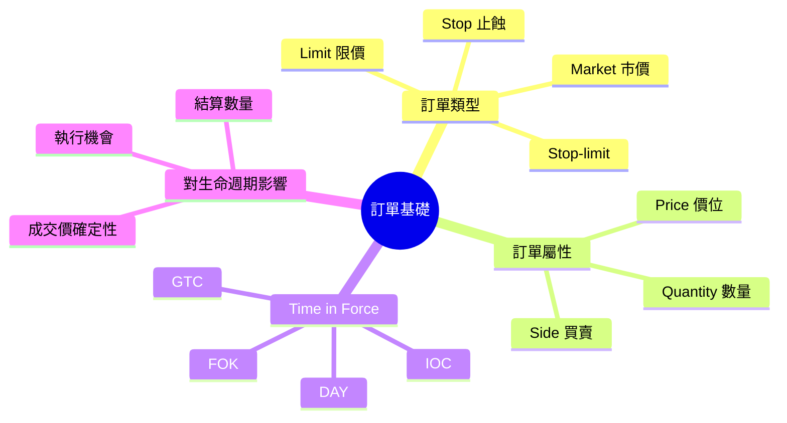
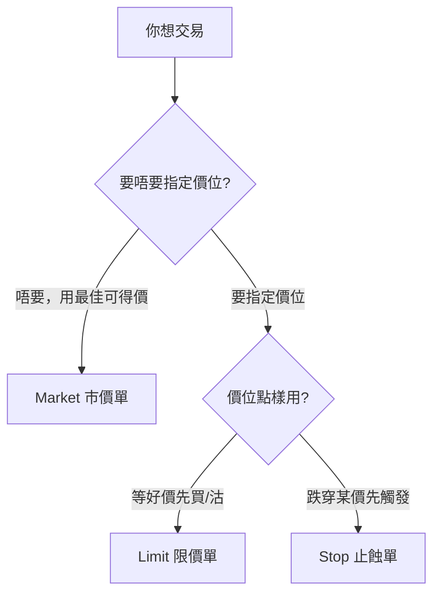
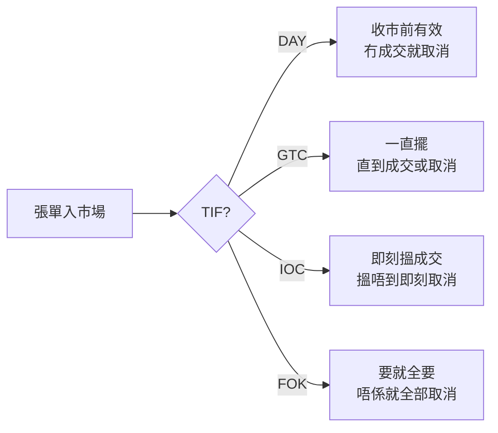

# Module 03: 訂單基礎

Est. study time: 1h
Language: yue
Description: market/limit/stop 訂單分別、time-in-force、訂單屬性（price、quantity、TIF）點樣影響執行同結算

## Knowledge Map

---

## Learning Objectives
- 分辨 market、limit、stop 三種基本訂單嘅分別
- 解釋 time-in-force（GTC/IOC/FOK/DAY）點樣影響訂單命運
- 講出訂單屬性點樣影響執行環節同後續結算

---

## Real-World Example

陳生想買匯豐，現價 $64.5。佢有三個選擇：

1. **市價單**：「即刻用市價買 1,000 股」——即刻入隊用最佳可得價，近乎一定成交；成交價可能 $64.6 或者更高。
2. **限價單**：「唔高過 $64 先買」——可能全日都等唔到，或者部分成交。
3. **止蝕單（stop-buy）**：「升穿 $66 先追入」——平時唔會動，升穿 $66 先觸發追貨。

同一個意圖（買匯豐），三張單嘅「命運」完全不同。**訂單類型決定你幾時成交、用咩價成交、定係根本成交唔到**。

> **Think**: 你急住買貨，用市價單定限價單好？點解？
>
> *Answer: 市價單。市價單會即刻入隊、用當前最佳可得價——近乎一定成交，但唔保證價位。限價單保證價位，但唔保證成交。急住持貨嘅話，成交優先於價位——因為你唔成交，後面配對、清算、結算全部行唔到。*

---

## Core Content

### Section 1: 三種基本訂單

| 訂單類型 | 成交保證 | 價格保證 | 適合場景 |
|---|---|---|---|
| Market 市價 | 有（近乎一定） | 冇 | 急住成交，唔介意價差 |
| Limit 限價 | 冇 | 有 | 想等好價，唔急 |
| Stop 止蝕 | 觸發後變市價 | 冇 | 止蝕（跌穿沽）、追貨 stop-buy（升穿追入） |

**備註**：Market maker 提供流動性，會跟 market price 買賣——所以正常時段市價單近乎一定有人接（細股、大單、停牌、開市頭幾秒例外）。但成交唔係問題，**價先係問題**：市價單會漂（slippage），落單前諗清楚值唔值呢個價。

**Stop 單嘅運作**：匯豐現價 $64.5，你 set 止蝕 $60。平時張單「瞓覺」，唔會動。一旦市價跌穿 $60，系統即刻將佢變成市價單送出市場——所以你最終成交價可能 $59.8 或者更低（滑價 slippage）。

**Stop-limit**：觸發條件用 stop（跌穿/升穿某價先啟動），但觸發後唔係變市價單，係變**限價單**——要指定價先成交。好處係限住最差價；代價係觸發後市價已經走遠嘅話，可能成交唔到。

> **Think**: 止蝕單點解唔可以保證你 $60 買入/賣出？
>
> *Answer: 因為觸發後佢變咗市價單。如果市價一口氣由 $60.1 跌到 $59，你張止蝕單會喺 $59 附近成交，唔係 $60。大跌時流動性差，滑價會更大。*

> **Cloze**: "市價單（{market order}）近乎一定 {成交}，但唔保證價位；限價單（{limit order}）保證價位但唔保證成交。"
>
> *Answer: market order / 成交*

> **Predict**: 你 set 限價單 $64 買匯豐，全日最高位 $64.05、最低 $63.8。你覺得成交咗未？
>
> *Answer: 成交咗。限價買單喺市價跌穿或者等於 $64 時觸發。全日有 $63.8 嘅低位，低過你嘅 $64，所以你會喺 $64 或者更低價成交。*

### Section 2: Time in Force — 訂單嘅「有效期限」

TIF 決定張單擺幾耐：

| TIF | 全名 | 意思 | 一句講法 |
|---|---|---|---|
| DAY | Day | 只限今日 | 收市前冇成交就自動取消 |
| GTC | Good Till Cancel | 直到取消 | 擺喺度等人成交，唔成交唔走 |
| IOC | Immediate or Cancel | 即刻，唔得就取消 | 搵到幾多成交幾多，剩低即刻取消 |
| FOK | Fill or Kill | 全部成交或者取消 | 要就全要，唔要就唔要 |

**對生命週期嘅影響**：TIF 直接影響「執行」環節會唔會發生。GTC 單可以擺幾日，所以你嘅「落單」同「執行」可能隔好遠；IOC/FOK 喺幾秒內就有結局。後續嘅配對、結算只有喺「真係成交咗」先至會發生。

> **Think**: 你用 GTC 限價單，三日後先成交。咁你嘅 settlement date 係計「落單日」定「成交日」？
>
> *Answer: 成交日（trade date）。生命週期嘅時間軸由成交嗰一刻開始計，唔係落單嗰一刻。香港股票 T+2 係由 trade date 起計 2 個工作天。*

### Section 3: 訂單屬性點樣影響後續環節

一張完整嘅訂單至少包含呢啲屬性：

| 屬性 | 影響邊個環節 |
|---|---|
| Side（買/賣） | 決定你係俾錢定收錢 |
| Quantity（數量） | 決定結算時要過幾多貨/幾多錢 |
| Price（價位） | 決定成交金額，影響佣金、印花稅計算 |
| TIF | 決定訂單幾時失效 |
| Account（戶口） | 決定邊個戶口承擔，影響分配 |

**點解數量咁重要**：如果你落單 1,000 股，但執行時只成交咗 500 股（partial fill 部分成交），咁配對、清算、結算全部只會處理嗰 500 股。剩低 500 股會繼續等（GTC）或者取消（IOC）。

> **Spot the Mistake**: 你落咗張限價單買 1,000 股，見到 App 顯示「部分成交 600 股」，你以為係系統出錯，即刻打去投訴要取消剩低 400 股。但你用嘅係 GTC 訂單。
>
> 邊度錯？
>
> *Answer: 部分成交（partial fill）唔係出錯，係正常現象。市場冇咁多貨即刻俾你，所以成交咗一部分。你用 GTC，剩低 400 股會繼續喺度等成交。想即刻取消，你要手動 cancel 剩低嗰部分，或者改用 IOC 訂單（一開始就限定唔要剩貨）。*

---

## Why This Matters

訂單係生命週期嘅「種子」——佢嘅屬性決定之後每一步點走。識得揀訂單類型同 TIF，你先至控制到「幾時成交、咩價成交、成交幾多」。呢啲全部直接影響你最後喺月結單見到嘅數字。

---

## Key Takeaways
- Market 近乎一定成交但唔保證價位（落單前諗值唔值）；Limit 保證價唔保證成交；Stop 觸發後變市價；Stop-limit 觸發後變限價單
- TIF：DAY（今日）、GTC（直到取消）、IOC（即刻唔得就取消）、FOK（全要或者全唔要）
- Partial fill（部分成交）係正常，剩低部分跟 TIF 走
- 結算時間軸由 trade date（成交日）起計，唔係落單日

---

## Common Misconception

**「限價單一定會用你指定嘅價成交。」**

錯。限價單保證「唔會比你指定嘅價更差」，但唔保證成交。如果市價一直冇跌到你嘅價位，張單會一直等（GTC）或者到期取消（DAY）。另外，開市時段如果市價一口氣穿過你嘅價位，你可能會喺更好嘅價成交（limit buy 喺 $64，市價跳到 $63，你喺 $63 成交）。

---

## Spot the Mistake

你見到隻股票急升，想追貨，於是落咗張限價單，價位設喺「現價」。結果見到市價升咗上去，你張單永遠成交唔到。你諗：「點解我追貨追唔到？」

邊度錯？

*Answer: 你用限價單追貨，但價位設死咗。市價升穿你嘅價位後，限價買單唔會自動追價——佢只會喺你指定嘅價或者更低先成交。急住追貨要用市價單（market order），近乎一定成交，代價係可能買貴啲——落單前先諗清楚值唔值呢個價。*

---

## Feynman Explain

(用「搭的士」做類比解釋三種訂單。提示：的士揚手即走 = market（近乎一定上到車，但唔包的士價）；指定價錢先肯上車 = limit；等到某個鐘數先截車 = stop。講吓每種嘅好處同代價。)

---

## Reframe

(諗吓：你而家用開嘅交易 App，你通常用邊種訂單？佢嘅 TIF 係咩？呢個組合啱唔啱你嘅交易風格？如果你成日「追唔到貨」或者「估唔到頂」，換一種訂單會唔會幫到你？)

---

## Drill
Take the quiz. MCQs test recall + application + scenario.

Run: `learn.sh quiz trade-lifecycle 03-order-basics`
Run: `learn.sh cloze trade-lifecycle 03-order-basics`
