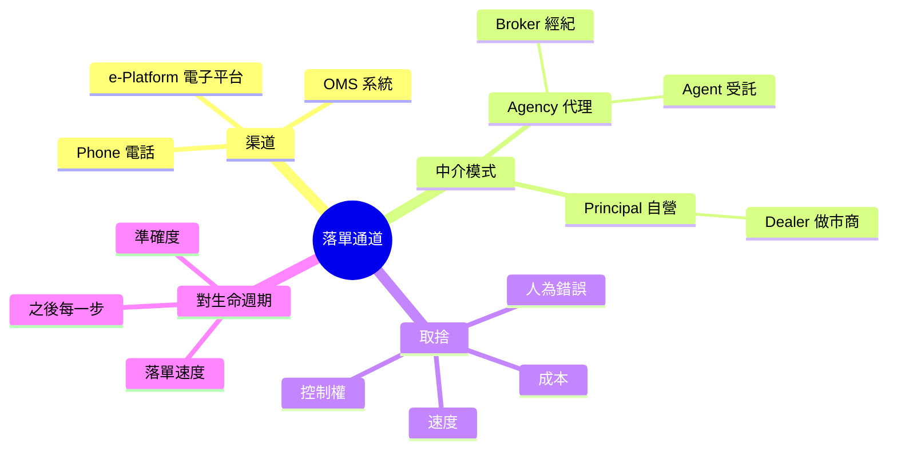
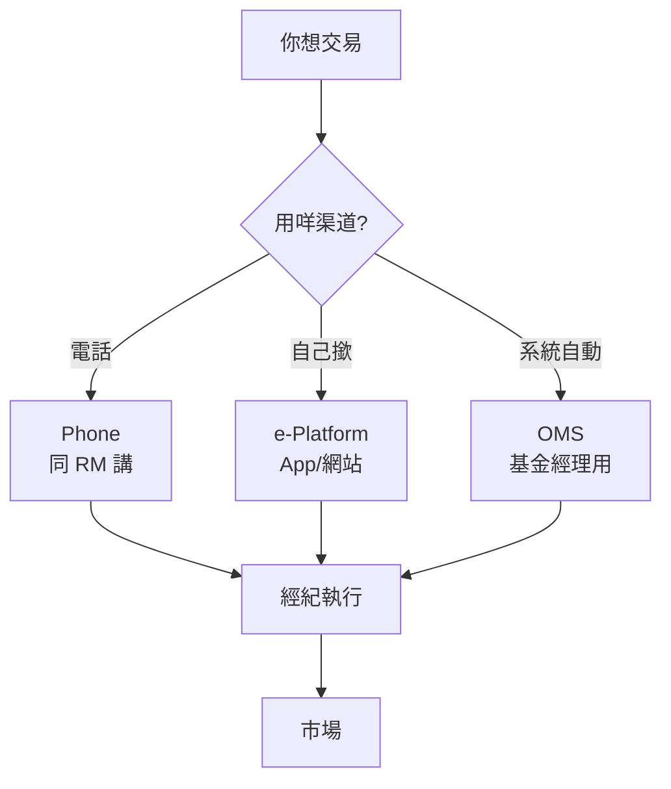
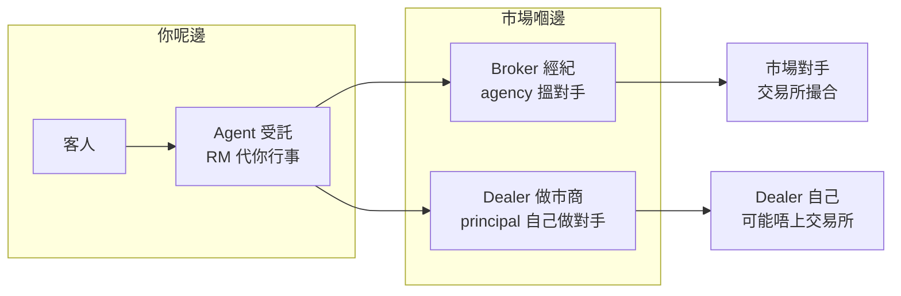

# Module 04: 落單通道：渠道同中介

Est. study time: 1h
Language: yue
description: 下單渠道（phone/e-platform/OMS）、agency vs principal 中介模式、渠道對錯誤風險同控制權嘅影響

## Knowledge Map

---

## Learning Objectives
- 講出三種主要下單渠道嘅分別同取捨（速度/控制/錯誤風險/成本）
- 分辨 agency 同 principal 兩種中介模式，以及 broker、dealer、agent 各自企邊
- 解釋渠道點樣影響落單環節嘅準確度同後續步驟

---

## Real-World Example

陳生想買 10,000 股匯豐。佢有三個渠道：

1. **打電話俾 RM**：「幫我買 10,000 股匯豐」——RM 幫佢落單，收佣金。
2. **用手機 App**：自己喺 App 度撳「買入」——App 背後經紀幫佢執行。
3. **公司 OMS**：基金經理用系統自動落單——系統根據算法搵最佳執行。

三個渠道最終都會將張單送去市場，但**速度、控制權、出錯風險、成本唔同**。另外，App 顯示「做市商報價」嗰刻，對面係 dealer——principal 模式，直接同你成交。

> **Think**: 你用 App 自己撳落單，同叫 RM 幫你電話落單，最大分別係乜？
>
> *Answer: 控制權同出錯風險。App 快、你自己睇住，但冇人幫你把關（落錯數量要自己負責）；電話慢、要等 RM，但有人覆述確認，人為錯誤有第二雙眼。OMS 最快但要預先設定規則，唔適合偶發交易。*

---

## Core Content

### Section 1: 三種下單渠道

| 渠道 | 誰落單 | 速度 | 控制權 | 主要風險 | 適合邊個 |
|---|---|---|---|---|---|
| Phone 電話 | 你話俾 RM 聽 | 慢（要等 RM） | 低——交俾人 | 聽錯數量/價位 | 唔熟 App、想有人跟 |
| e-Platform | 你自己撳 | 快 | 高——自己睇 | 落錯單冇人把關 | 有經驗、想自己控制 |
| OMS 系統 | 系統自動 | 最快 | 中——跟預設規則 | 規則設錯會批量出錯 | 機構、基金經理 |

**渠道取捨一句**：快 ↔ 有人把關；自己控制 ↔ 交俾人。冇完美渠道，只有啱你交易風格嘅渠道。

**OMS 點解要預設規則**：基金經理唔會逐張撳掣——系統根據預設條件（限價範圍、拆單大小、時間窗口）自動執行。規則啱就快且一致；規則錯就系統性出錯，所以 OMS 要有 pre-trade check 同人手 override。

### Section 2: 中介模式——Agency vs Principal

中介只有兩種模式，分界係一句：**佢係「幫你搵對手」定「自己做你對手」**。

**Agency 代理模式**——企你嗰邊，幫你搵對手，唔持倉：
- 共同點：賺佣金/手續費、利益同你一致、成交佢先賺
- **Broker 經紀**：幫你**執行一單**——搵市場對手、成交就完
- **Agent 受託**：**受你指示代你行事**——可以係持續關係，典型係 RM 幫你落單、跟單

Broker 同 Agent 都屬 agency，唔使對比——一個講「執行呢一單」，一個講「受託呢段關係」。

**Principal 自營模式**——自己持倉，直接做你對手：
- **Dealer 做市商**：賺 spread，你成交嗰刻佢就係對手——佢沽俾你，可能希望你蝕，利益可能相反

**點樣分（實用）**：成交後有佣金計費單 → agency 路徑；App 顯示「做市商報價」同交易所價有差距 → principal 路徑。

**對生命週期嘅影響**：
- Agency（經紀執行）：張單上交易所撮合，配對環節正常走。
- Principal（同 dealer 成交）：可能唔上交易所撮合——配對、結算路徑會唔同。
- Agent（RM 受託）：影響落單準確度，後續路徑跟翻執行嗰邊行邊條。

### Section 3: 渠道點樣影響後續環節

渠道唔係淨係「方便唔方便」——佢直接影響生命週期質素：

| 影響 | 點解 |
|---|---|
| 準確度 | 電話靠人覆述；App 靠你睇清楚；OMS 靠規則設定。錯咗數量，後面配對、結算全部跟住錯 |
| 速度 | 慢渠道可能錯過價位；快渠道可能冇時間覆核 |
| 資訊洩漏 | 大單經人手講出，有機會洩漏意圖；OMS 拆單可以減少市場衝擊 |
| 成本 | 電話/有人跟通常佣金高；自己撳可能平啲；OMS 有系統成本 |

> **Think**: 私人銀行嘅 RM 幫客人電話落單，RM 屬於邊個部門？佢嘅工作點影響生命週期？
>
> *Answer: RM 屬於 Front Office。佢係「落單」環節嘅發起人，將客人嘅意圖轉化成正式訂單。佢嘅準確度直接影響之後每一步——聽錯數量，後面配對、結算全部錯。*

> **Predict**: 基金經理要買 500,000 股，用電話逐張落定係用 OMS 拆單執行？
>
> *Answer: OMS 拆單。電話逐張落又慢又容易錯，而且大單意圖會洩漏；OMS 可以按預設規則拆細、控制時間同價位範圍，減少市場衝擊。*

> **Cloze**: "中介兩種模式：{agency} 代理幫你搵對手（broker/agent，賺佣金）；{principal} 自營自己做你對手（dealer，賺 spread）。"
>
> *Answer: agency / principal*
---

## Why This Matters

落單渠道同中介模式決定你嘅單「點樣入系統、邊個幫手、行邊條路」。同樣係買匯豐，用電話 RM 落單、用 App 自己撳、用 OMS 自動執行，速度、錯誤風險、成本都唔同。明白 agency 同 principal，你先至知自己張單係搵市場對手定係同做市商對賭、利益係咪一致。

---

## Key Takeaways
- 三種渠道取捨：Phone（慢但有人跟）、e-Platform（快但自己負責）、OMS（最快但要預設規則）
- 中介兩種模式：Agency 代理（broker 執行一單 / agent 受託如 RM，賺佣金，利益同你一致）vs Principal 自營（dealer 自己做對手，賺 spread，利益可能相反）
- 分界一句：幫你搵對手 = agency；自己做你對手 = principal
- 渠道影響準確度、速度、資訊洩漏、成本——錯咗後面全部跟住錯
- RM 屬於 Front Office，係落單環節嘅發起人

---

## Common Misconception

**「經紀一定同我企同一邊。」**

agency 模式（broker/agent）係——佢哋搵對手、收佣金，利益同你一致。但如果 App 顯示「做市商報價」，背後係 principal 模式：dealer 自己做你對手賺 spread，佢沽俾你嗰刻可能希望你蝕。落單前要分清行邊條路——佣金計費單定係做市商報價。

---

## Spot the Mistake

客人投訴：「我打電話俾 RM 落單，RM 聽錯數量，買多咗一倍，搞到我蝕錢！」佢覺得係系統問題，要求券商全賠。

邊度錯？

*Answer: 電話渠道靠人手輸入，人為錯誤係已知風險——所以正確做法係 RM 落單後要覆述確認（數量、價位、方向），客人確認先送出。客人冇覆核都有責任。系統問題（e-Platform/OMS）同人為錯誤（Phone）係兩回事，賠唔賠取決於邊個環節出錯、有冇確認紀錄。*

---

## Feynman Explain

(用「叫外賣」做類比解釋三種渠道。提示：打電話落單 = Phone（有人覆述但可能聽錯）；自己喺 App 撳 = e-Platform（快但落錯自己負責）；訂閱每朝自動送 = OMS（最準但要預設好）。再用「邊個收錢」解釋兩種模式：平台抽佣/跑腿費 = agency；檔主賺差價 = principal。)

---

## Reframe

(諗吓：你而家用開邊種渠道落單？你張單係佣金計費定係做市商報價——agency 定 principal？你知唔知？如果唔知，點樣查？如果你成日「聽錯/撳錯」，換一種渠道會唔會幫到你？)

---

## Drill
Take the quiz. MCQs test recall + application + scenario.

Run: `learn.sh quiz trade-lifecycle 04-order-placement`
Run: `learn.sh cloze trade-lifecycle 04-order-placement`
