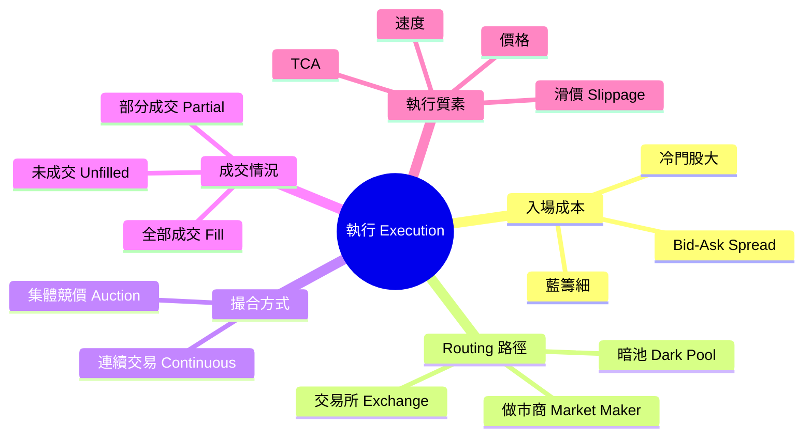
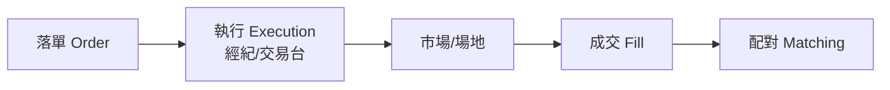
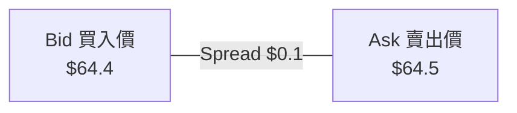
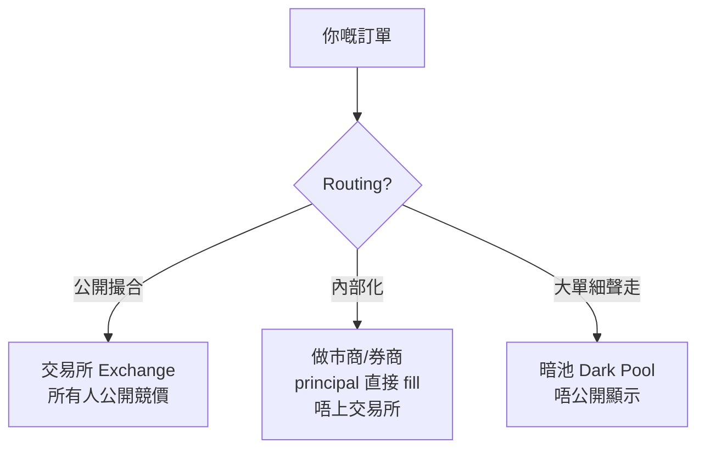
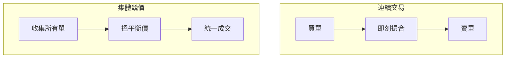

# Module 05: 執行：由訂單到成交

Est. study time: 1h
Language: yue
Description: 執行環節做乜、bid-ask spread 入場成本、order routing 路徑、交易場地（auction vs continuous）、partial fill、執行質素（TCA）

## Knowledge Map

---

## Learning Objectives
- 講出執行環節由邊個負責、做乜
- 解釋 bid-ask spread 點樣影響你嘅交易成本
- 講出路由三條路（交易所/做市商/暗池）嘅分別
- 分辨連續交易同集體競價兩種撮合方式
- 解釋 partial fill 同執行質素點樣影響你嘅最終成本

---

## Real-World Example

開市 9:30，陳生嘅 10,000 股匯豐市價單入咗市場。頭 3 秒成交咗 6,000 股 @ $64.5，剩低 4,000 股喺 9:31 先成交 @ $64.6——因為開市後買盤湧入，價升咗。

呢個就係執行（execution）：**將你嘅意圖變成市場上真係有人同你成交嘅事實**。陳生嘅單屬於 partial fill（部分成交），而且第二部分成交價貴咗 $0.1。

另外，陳生見到 App 顯示匯豐「買入 $64.4 / 賣出 $64.5」——佢買入用 $64.5（ask），帳面估值用 $64.4（bid），呢個 $0.1 差價就係 spread，係佢嘅「入場費」。

> **Think**: 你用 App 買入匯豐嗰一刻，即刻睇帳面係賺定蝕？
>
> *Answer: 即刻蝕。因為你買入用 $64.5（ask），但帳面估值用 $64.4（bid）。呢個 $0.1 差價就係 spread，係你嘅「入場費」。要帳面轉正，匯豐要升超過 spread。*

---

## Core Content

### Section 1: 執行環節做乜

執行係生命週期嘅第二步，由經紀/交易台負責：

執行環節嘅核心問題：**用咩價、幾快、成交幾多**。呢三個問題嘅答案，決定你之後配對、結算見到嘅數字。

### Section 2: Bid-Ask Spread — 你嘅入場成本

每隻股票都有兩個價：

| 價格 | 意思 | 誰用呢個價 |
|---|---|---|
| Bid 買入價 | 市場有人願意用呢個價買 | 你想沽貨，用呢個價 |
| Ask 賣出價 | 市場有人願意用呢個價賣 | 你想買貨，用呢個價 |
| Spread 差價 | Ask - Bid | 你嘅「入場費」 |

**點解有 spread**：做市商（market maker）用低價買入、高價賣出賺差價。呢個就係佢提供流動性嘅回報——市場價成交嘅背後，有人食呢個差。

**spread 同流動性**：
- 冷門股 spread **大**——交易少、難對沖，做市商要求更大回報先肯提供流動性
- 藍籌股 spread **細**——交易頻繁、容易對沖
- spread 寬 = 流動性差 = 你執行嘅隱性成本高

**對生命週期嘅影響**：spread 影響「執行」環節嘅實際成本。你買入用 ask、沽出用 bid，所以一買一沽即刻「蝕」咗 spread。呢個成本會入咗去結算金額度，影響你最後嘅回報。

> **Predict**: 你買入匯豐 $64.5，即刻帳面蝕 $0.1 spread。匯豐要升幾多你先回本？
>
> *Answer: 要升超過 $0.1（即 spread 幅度）你先回本。因為你沽出時用 bid 價，假設 spread 唔變，你要 bid 價升穿你嘅買入價先賺錢。*

> **Cloze**: "bid-ask spread 係 {買入價} 同 {賣出價} 嘅差額，係你嘅隱形交易成本。"
>
> *Answer: 買入價 / 賣出價*

### Section 3: Order Routing — 張單行邊條路

張單入咗系統之後，要決定送去邊度成交。三條路：

| 路徑 | 運作 | 好處 | 代價 |
|---|---|---|---|
| 交易所 | 上公開市場撮合——MM 都可以喺度報價，你同邊個撮合都係呢條路 | 價格透明、公平競價 | 大單會俾人見到意圖 |
| 做市商/內部化 | 券商或 MM 以 principal 直接同你 fill，**唔上交易所**（App「做市商報價」行呢條） | 即刻有報價、快 | 價差可能比交易所闊；利益可能相反 |
| 暗池 | 不公開顯示嘅池，大單拆細撮合 | 減少資訊洩漏、衝擊細 | 流動性未必夠、價未必最優 |

**點解 routing 重要**：同一張單，行唔同路徑，速度、價格、被見到嘅風險都唔同。機構會揀路由策略（smart order routing）搵最佳執行；散户通常經券商 default 路由，未必知自己張單去咗邊。

**對生命週期嘅影響**：routing 決定「執行」環節去邊個場地發生——交易所撮合嘅交易正常行配對；做市商內部化/暗池成交可能有唔同確認路徑。之後嘅配對、結算都要知成交喺邊度發生。

> **Think**: 大基金要沽 200 萬股，直接掃交易所定係拆去暗池？點解？
>
> *Answer: 拆去暗池或者拆細慢慢執行。直接掃交易所會公開顯示大賣壓，其他人跟住沽，價即刻跌（市場衝擊）。暗池唔公開顯示，可以減少資訊洩漏，但要留意流動性未必夠。*

### Section 4: 兩種撮合方式

| 方式 | 運作 | 適合 |
|---|---|---|
| 連續交易 Continuous | 開市時段一路有人就即刻撮合 | 日常交易 |
| 集體競價 Auction | 某個時刻（開市/收市）統一撮合 | 開市、收市、停牌復牌 |

**點解開市有競價**：開市前累積咗好多單（隔夜單、收市後落嘅單），用競價一次過搵個「最多人接受嘅價」，避免開市瞬間亂跳。香港股票開市前有 pre-opening session（9:00-9:30）做競價。

> **Think**: 點解收市都有競價？收市後冇人交易啦。
>
> *Answer: 收市競價（closing auction）係為咗搵一個「收市價」，俾基金估值、指數計算用。因為如果用最後一筆零星交易做收市價，好容易俾人操控。統一競價搵出嘅價比較公平。*

### Section 5: Partial Fill 同執行質素

**Partial fill**：你落單 10,000 股，市場即刻有嘅貨唔夠，所以分批成交。呢個唔係錯誤，係正常——流動性有限。

**執行質素**常用嘅衡量：

| 指標 | 意思 |
|---|---|
| Slippage 滑價 | 實際成交價 vs 你期望價 |
| Fill rate 成交率 | 成交咗幾多（10,000 股成交 6,000 = 60%） |
| 時間 | 幾快成交 |
| Market impact 市場衝擊 | 你張單令價位移動咗幾多 |

**TCA（Transaction Cost Analysis）**：機構會用 TCA 報告分析「我哋嘅執行貴唔貴」。私人銀行客人通常唔會自己做 TCA，但明白概念有助你理解「點解有啲執行貴過有啲」。

**spread 同執行質素嘅關係**：spread 寬嘅股票，你一入場就蝕多啲——執行成本已經高。再加 market impact（大單掃貨），冷門股大單可以好貴。所以大單通常拆細慢慢執行（TWAP/VWAP 算法）。

> **Predict**: 你落市價單買 50,000 股冷門股，成交後發現價比預期貴咗 2%。最可能嘅原因係乜？
>
> *Answer: 市場衝擊（market impact）+ 大 spread。冷門股流動性差，你一張大單掃走晒啲平貨，價即刻飆升，之後嘅貨越嚟越貴。所以大單通常會拆細慢慢執行（TWAP/VWAP 算法）。*

> **Spot the Mistake**: 有新手見到自己張單「部分成交 60%」，好嬲：「剩低 40% 咁咪蝕咗機會？」即刻取消剩低部分，然後眼見價繼續升。
>
> 邊度錯？
>
> *Answer: 混淆咗「未成交」同「蝕咗」。剩低 40% 未成交，唔代表你蝕咗——你只係未買齊。取消張單之後價繼續升，你先至真係蝕咗機會（機會成本）。正確做法係評估：繼續等（GTC）定係追價（改市價單）。*

---

## Why This Matters

執行係你控制成本最直接嘅環節。同樣嘅意圖，快同慢、拆單同掃單、行交易所定暗池，最終成本可以差好遠。明白 spread 係入場費、routing 決定路徑、partial fill 同市場衝擊係正常，你先至唔會喺流動性差嘅股票度一注掃入，然後怪執行貴。

---

## Key Takeaways
- 執行係由經紀/交易台負責，將意圖變成成交事實
- Bid-ask spread 係入場費：買入用 ask、沽出用 bid；冷門股大、藍籌細
- Routing 三條路：交易所（透明，MM 報價都屬呢條）、做市商內部化（principal 直接 fill 唔上交易所）、暗池（減洩漏）
- 連續交易（日常）vs 集體競價（開市/收市）
- Partial fill 係正常，唔係錯誤
- 執行質素：滑價、成交率、時間、市場衝擊；大單冷門股應拆細執行

---

## Common Misconception

**「App 顯示嘅價就係交易所嘅價。」**

錯。App 顯示嘅可能係做市商報價，同交易所撮合價有差距。另外，App 顯示嘅「現價」通常係最後成交價（last price），唔係你即刻可以交易到嘅價（bid/ask）。你要買入嘅話，要用 ask 價。

---

## Spot the Mistake

你用 App 買入一隻股票，見到成交價比你預期貴咗 $0.02，即刻投訴「滑價嚴重」。但你落單嗰陣，市價正喺度急升。

邊度錯？

*Answer: 你落單時市價急升，你嘅市價單會用「當前最佳賣出價」成交，而唔係你落單瞬間嘅價。呢個唔係滑價（slippage），係市價單嘅正常行為。滑價係指「預期價同實際價嘅差距」，喺急市時係無可避免嘅。想避免，用限價單，但代價係可能成交唔到。*

---

## Feynman Explain

(用「街市買魚」做類比解釋執行同 spread。提示：你話「我要買 10 條魚」= 落單；魚檔即刻有 6 條 = partial fill；你要等佢去倉度攞埋另外 4 條 = 繼續等；佢話「而家貴咗，要唔要？」= 滑價；老闆 bid $40 買你條魚、ask $45 賣俾你，$5 差價 = spread。再講吓你張單行邊條路（當面買 / 托人買 / 大單靜靜雞買 = routing）。)

---

## Reframe

(諗吓：你有冇試過「追唔到貨」或者「估唔到頂」？而家你覺得係執行問題定係你自己嘅價位/訂單類型問題？你知唔知自己張單通常行邊條路由？寫低你嘅分析。)

---

## Drill
Take the quiz. MCQs test recall + application + scenario.

Run: `learn.sh quiz trade-lifecycle 05-execution`
Run: `learn.sh cloze trade-lifecycle 05-execution`
