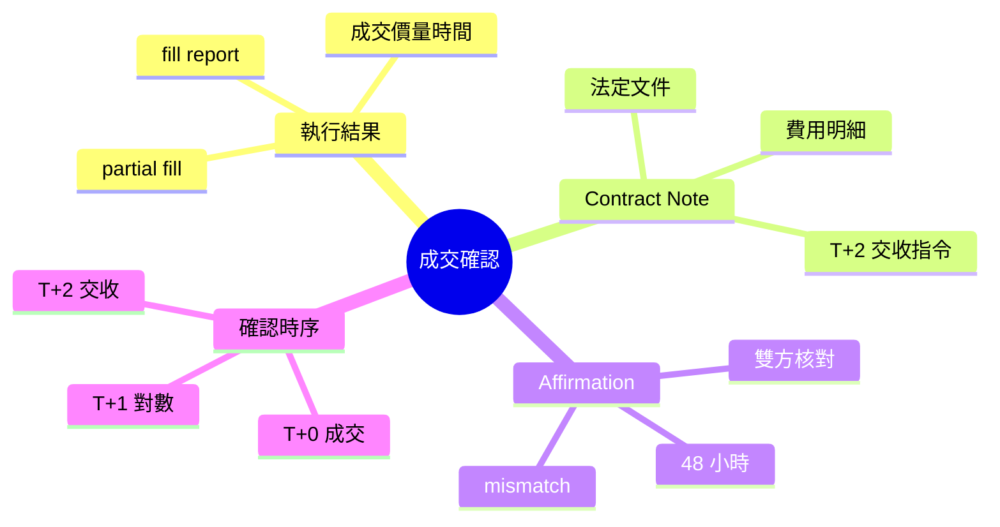
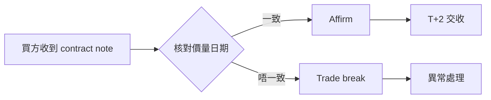

# Module 06: 成交確認同 Contract Note

Est. study time: 1h
Language: yue
Description: fill report 同 contract note 分別、affirmation 防錯、香港 T+2 確認時序、費用結構點影響回報

## Knowledge Map



## Learning Objectives

1. 認識 fill report 同 contract note 嘅分別
2. 理解 affirmation 點樣防止對數錯誤
3. 記住香港 T+2 確認時序
4. 識得睇 contract note 上面嘅費用結構

## Real-World Example

陳生喺 10 月 5 日以每股 HKD 150 買入 1,000 股匯豐。當日收到經紀 email：「成交 1,000 股 @ 150.00，成交日期 5/10」。呢個係 fill report——話你知交易成立。

當日或最遲 T+2 收到正式 contract note：成交價 150.00、佣金 HKD 50、印花稅 HKD 150、交收日期 7/10。呢個係法定文件，列明所有費用。

之後托管行發出 statement，數目啱晒，呢個係對帳結果。

## Core Content

### Section 1: 執行結果報告（fill report）

經紀喺成交後即刻或當日發出 fill report，內容：

| 項目 | 內容 | 時間 |
|------|------|------|
| 成交價 | 每股價格 | T+0 |
| 成交量 | 買入/賣出股數 | T+0 |
| 成交日期 | trade date | T+0 |
| 訂單狀態 | filled / partial fill | T+0 |

> **Think**：fill report 有冇法律效力？

Fill report 唔係法定成交單據——法定文件係 contract note。但佢係交易記錄，爭議時可用作證據，亦係監管要求嘅即時確認。

*Answer: 非法定成交單據，但係交易證據 + 即時確認。*

> **Cloze**: fill report = 即時{成交}通知；Contract Note = {法律}文件列費用；affirmation 限期 {48} 小時。
>
> *Answer: 成交 / 法律 / 48*

### Section 2: Contract Note

Contract note 係經紀發出嘅法定交易確認文件，香港《證券及期貨條例》規定必須發出。

內容包括：

| 項目 | 說明 |
|------|------|
| 成交價 | 每股價格 |
| 成交量 | 股數 |
| 佣金 | 經紀佣金 |
| 印花稅 | 政府稅項 |
| 交易徵費 | 監管機構費用 |
| 交收日期 | 通常 T+2 |

> **Think**：contract note 同 fill report 最大分別係咩？

Fill report 話你知「交易成立」，contract note 話你知「交易成本」。後者列明所有費用，係對帳嘅基礎。

*Answer: fill report = 成交通知；contract note = 法定費用文件。*

### Section 3: Affirmation（確認）

Affirmation 係買賣雙方核對成交細節嘅過程：



香港銀行公會規定，affirmation 應喺 T+1 完成。超過 48 小時未 affirm 嘅交易會進入 unmatched 狀態。

> **Predict**：如果你收到嘅 contract note 成交價同自己記憶唔同，第一步做咩？

先核對 fill report 同 OMS 記錄，再聯絡經紀。唔好直接去托管行，因為數字可能喺中間環節出錯。

*Answer: 核對 fill report + OMS，再聯絡經紀。*

### Section 4: 確認時序

| 時點 | 事件 | 負責方 |
|------|------|--------|
| T+0 | 成交、fill report | 經紀 |
| T+0～T+2（法例最遲 T+2） | contract note 發出 | 經紀 |
| T+1 | affirmation 核對 | 買賣雙方 |
| T+2 | 交收 | 托管行 |

## Why This Matters

Contract note 係你同經紀之間嘅法律文件。上面嘅費用數字直接影響你嘅投資回報。忽略佣金同稅項，你嘅「賺錢」其實係蝕錢。

Affirmation 防止對數錯誤。冇 affirmation，錯誤會流到交收環節，變成 settlement fail，補救成本更高。

## Key Takeaways

- Fill report = 交易通知；contract note = 法定費用文件
- Contract note 列明佣金、印花稅、交收日期
- Affirmation 喺 T+1 完成，防止對數錯誤
- 確認時序：T+0 成交 → T+1 對數 → T+2 交收

## Common Misconception

好多人以為收到 contract note 就代表錢已經扣咗——錯。Contract note 只係交易確認，真正扣錢喺 T+2 交收嗰陣。Contract note 上面嘅費用係應付金額，唔係已付金額。

## Spot the Mistake

> **Spot the Mistake**：有人話「fill report 就係 contract note，一樣嘅」——錯。Fill report 係即時成交通知，唔係法定成交單據；contract note 先係法例規定嘅正式文件，列明所有費用。

## Feynman Explain

試下向一個完全唔識股票嘅朋友解釋：

1. 點解成交之後仲要等 T+2 先交收？
2. Contract note 同平日收到嘅 email 有咩唔同？
3. 如果 affirmation 發現數目唔啱，點算？

用最簡單嘅比喻解釋，唔好用專業術語。

## Reframe

你去餐廳食飯，埋單前侍應俾你睇帳單——呢個係 contract note。你核對菜式同價錢——呢個係 affirmation。最後你俾錢——呢個係 settlement。

成個流程同你平時消費一模一樣，只不過股票交易嘅金額大好多，所以每個步驟都要有文件記錄。

## Drill

回顧以上內容，試下回答：

1. Fill report 同 contract note 嘅核心分別係咩？
2. Affirmation 應該喺邊個時間完成？
3. Contract note 上面邊啲數字直接影響你嘅投資回報？
4. 如果 contract note 同 fill report 數目唔一致，第一步做咩？

```bash
learn.sh quiz trade-lifecycle 06-trade-confirmation
learn.sh cloze trade-lifecycle 06-trade-confirmation
```
