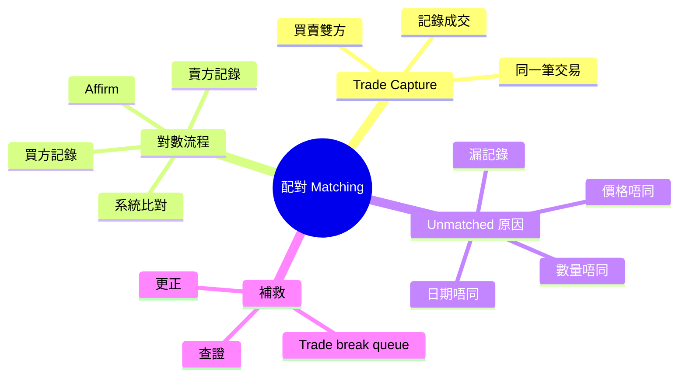
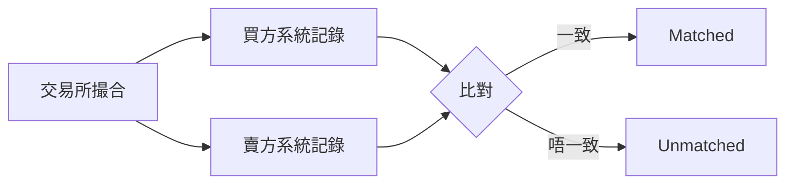
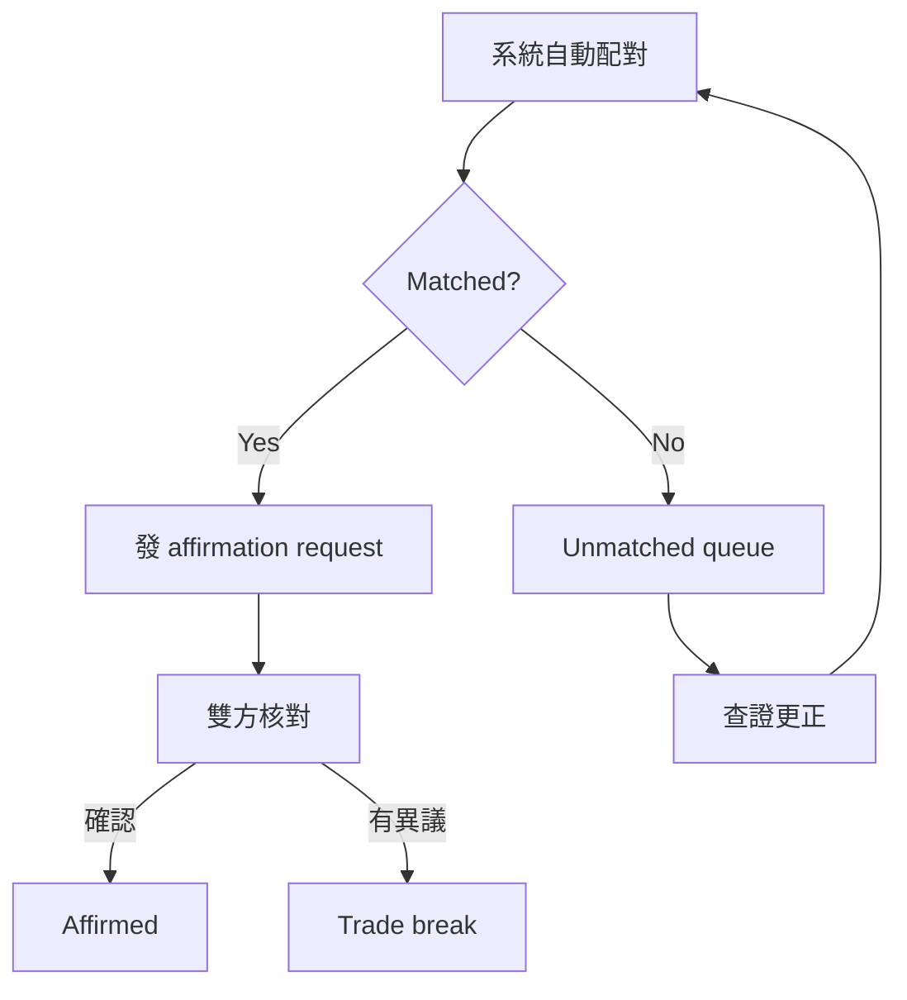

# Module 07: 配對：買賣雙方點對數

Est. study time: 1h
Language: yue
Description: trade capture 雙邊記錄、配對四欄比對、affirmation flow、unmatched 常見原因同補救

## Knowledge Map



## Learning Objectives

1. 理解 trade capture 點樣記錄成交
2. 認識配對（matching）嘅雙邊比對流程
3. 識別 unmatched trades 嘅常見原因
4. 理解 affirmation flow 點樣確保數目一致

## Real-World Example

A 基金以 HKD 50 買入 10,000 股中移動，B 經紀以同一價賣出。兩個系統各自記錄呢筆交易：

- A 嘅 OMS：買入 10,000 @ 50，counterparty = B
- B 嘅 OMS：賣出 10,000 @ 50，counterparty = A

配對系統自動比對兩邊記錄。價量日期全部一致 → matched，交易正式成立，可以進入分配同交收。

如果 B 錯手記錄成 10,000 @ 50.10，價錢唔同 → unmatched，要入 queue 查證。

## Core Content

### Section 1: Trade Capture（成交記錄）

Trade capture 係生命週期嘅記錄環節——將交易所撮合嘅結果，變成買賣雙方各自嘅交易記錄。



> **Think**：點解買賣雙方要各自記錄一次，而唔係共用一個系統？

因為雙方係獨立機構，各有自己嘅帳簿、風控、會計系統。獨立記錄先可以互相核對，防止一方出錯無人知。

*Answer: 雙方獨立機構、各有系統，獨立記錄先可互相核對。*

> **Cloze**: 配對四項：{價}、{量}、日期、證券代碼；任一唔一致 = {trade break}。
>
> *Answer: 價 / 量 / trade break*

### Section 2: 配對流程（Matching）

配對嘅核心係比對四個關鍵欄位：

| 欄位 | 買方記錄 | 賣方記錄 | 要求 |
|------|----------|----------|------|
| 價格 | 50.00 | 50.00 | 完全一致 |
| 數量 | 10,000 | 10,000 | 完全一致 |
| 交易日期 | 5/10 | 5/10 | 完全一致 |
| 證券代號 | 941 | 941 | 完全一致 |

四個欄位全部一致 → matched。任何一個唔一致 → unmatched。

> **Predict**：如果買方記錄 T+0 成交，賣方記錄 T+1 成交，配對結果會係咩？

Unmatched。交易日期唔同。通常係時區、系統入單延遲、或者一方補錄造成。要查證邊邊日期錯。

*Answer: Unmatched——交易日期唔一致。*

### Section 3: Affirmation Flow

Affirmation 係配對後嘅人工確認步驟：



系統自動配對只係第一步，affirmation 要人手確認數目正確。香港規定 T+1 完成。

機構單唔係靠 email 逐筆覆——業界用平台自動化：DTCC 嘅 **CTM**（Central Trade Manager）收雙方指令、自動比對，再用 **M2i**（Match to Instruct）將 affirmation 推俾托管行；**ALERT** 管 standing settlement instructions（SSI）。目標：allocation → confirmation → affirmation 全程電子，限時內完成先唔影響交收。

> **Think**：點解系統配對咗仲要人手 affirmation？

系統只比對欄位數字，唔知背後係咪真係呢筆交易。人手確認係最後防線，確保冇錯配（wrong match）。

*Answer: 系統只比對數字，人手確認係最後防線防錯配。*

### Section 4: Unmatched Trades 嘅常見原因

| 原因 | 例子 | 頻率 |
|------|------|------|
| 價格唔同 | 一邊 50.00，一邊 50.10 | 常見 |
| 數量唔同 | 一邊 10,000，一邊 1,000 | 常見 |
| 日期唔同 | 一邊 T+0，一邊 T+1 | 中等 |
| 漏記錄 | 一邊根本冇入單 | 少見但嚴重 |
| Counterparty 唔同 | 一邊記 A，一邊記 B | 少見 |

## Why This Matters

配對係交易正式成立嘅關卡。Matched 先可以入分配、清算、交收；unmatched 會阻塞成個後端流程。

私人銀行嘅 omnibus account 會增加配對複雜度——市場端只見銀行一個總戶口（真戶口喺 CSD，以銀行名義），但背後對應多個客戶，任何一個客戶數目錯，成筆交易都會 unmatched（結構詳見 Module 02）。

## Key Takeaways

- Trade capture = 買賣雙方各自記錄成交
- 配對比對四欄：價格、數量、日期、證券代號
- 系統配對後仲要人手 affirmation（T+1）；機構常用 CTM/M2i 自動化
- Unmatched 唔會自己消失，要即刻入 queue 處理

## Common Misconception

好多人以為「配對就係清算」——錯。配對（matching）只係確認交易成立，屬前端/中間環節；清算（clearing）係之後計算各方義務嘅過程。配對先，清算後，順序不能倒轉。

## Spot the Mistake

> **Spot the Mistake**：有人話「unmatched 唔緊要，等佢自己會變 matched」——錯。Unmatched 唔會自己消失，只會越嚟越難查（時間越耐，當事人越唔記得細節）。必須即刻入 queue 處理。

## Feynman Explain

試下向朋友解釋：

1. 點解買賣雙方要各自記錄同一筆交易？
2. 系統已經自動配對咗，點解仲要人手 affirm？
3. 如果 unmatched 唔理佢，會發生咩事？
4. CTM 喺 affirmation 流程做乜？

用你最熟嘅生活例子比喻（例如網購買賣雙方各自確認訂單）。

## Reframe

你同朋友夾錢買嘢，各自記低「我俾咗 50 元」。之後對數——你記 50，佢記 50，啱。如果佢記錯做 55，就要傾邊個啱。

配對就係呢個「對數」過程，只不過喺金融系統入面自動化咗，同埋每個數字都係真金白銀。

## Drill

1. 配對比對邊四個欄位？
2. 系統配對成功之後，下一步係咩？
3. 舉兩個 unmatched trades 常見原因
4. 點解 unmatched 唔可以唔理？

```bash
learn.sh quiz trade-lifecycle 07-trade-matching
learn.sh cloze trade-lifecycle 07-trade-matching
```
