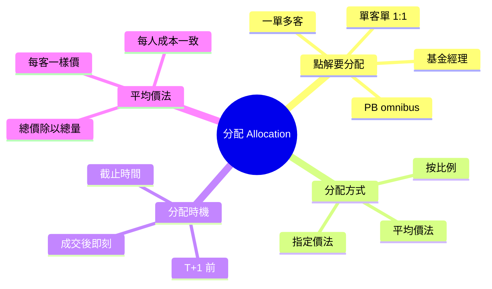
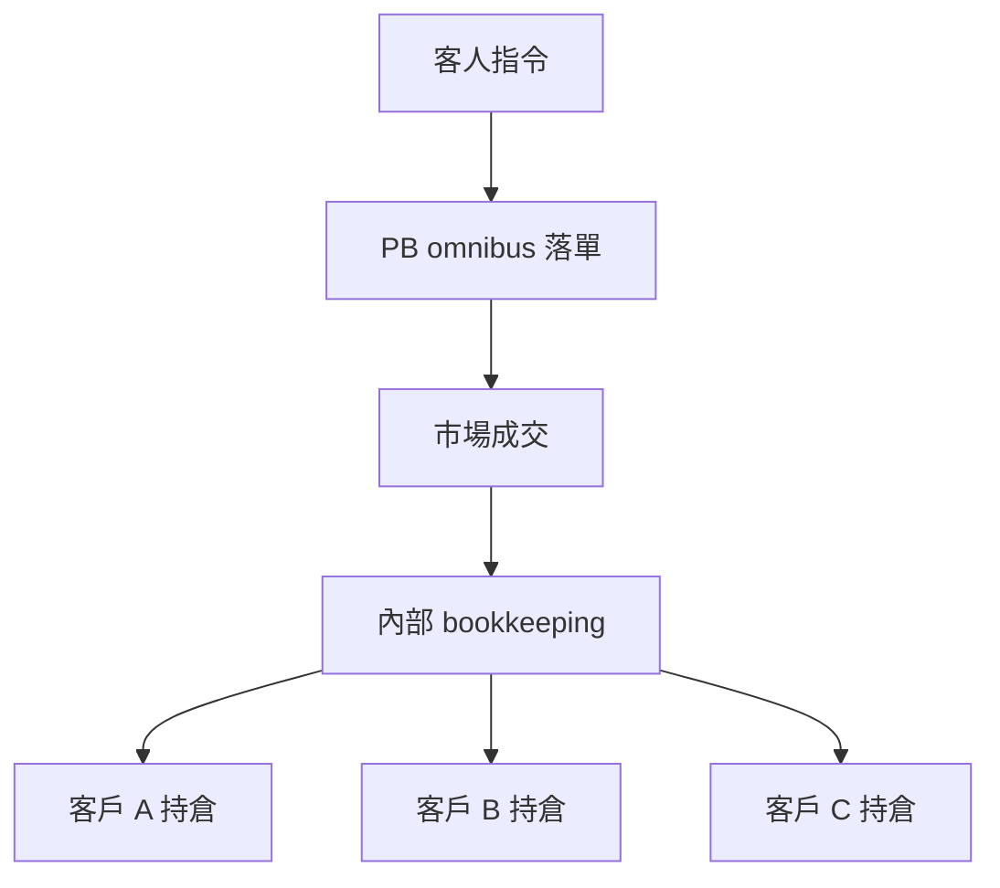

# Module 08: 分配：一單多客點分

## Knowledge Map



## Learning Objectives

1. 理解點解一單要分配俾多個客戶
2. 認識平均價法（average price）點樣運作
3. 理解 PB omnibus account 嘅分配層
4. 記住分配時機嘅截止要求
5. 解釋 omnibus 存在原因，比較單客同多客合併嘅好處

## Real-World Example

基金經理落一單買 100,000 股騰訊，呢一單要分配俾 50 個基金客戶。每個客户嘅目標持有量唔同：

- 客戶 A：目標 30,000 股
- 客戶 B：目標 40,000 股
- 客戶 C：目標 30,000 股

經紀用平均價法分配：總成本 = 100,000 × 平均价。每個客户按目標比例分攤，每人嘅每股成本都係同一個平均價。

呢個就係 allocation 嘅經典場景——將一單大交易拆散成多個客戶各自嘅持倉。但 allocation 本質只係「fill 入正確 account」，單客單一樣有（1:1）。

## Core Content

第一層：點解要分配

私人銀行同基金場景，一個經紀帳戶背後有多個最終客戶：

| 場景 | 一單來源 | 客戶數 | 分配需求 |
|------|----------|--------|----------|
| 基金經理 | 基金帳戶落單 | 50+ 基金份額持有人 | 按份額比例分 |
| PB omnibus | 客戶 A+B+C 合併落單 | 3 個客戶 | 按各自指令分 |
| 證券行 | 經紀代客落單 | 多個散戶 | 按指令分 |

> **Think**：點解唔逐個客戶各自落一單，要合併再分配？

合併落單慳佣金（大單議價）、減少市場衝擊（一次過攞貨）、提高成交率。代價唔係「有冇 allocation」——omnibus 單張單都要做（1:1 都要入 sub-account）。代價係 allocation 變複雜：多客要拆（平均價/按比例）、錯配風險高、要限時做完先唔影響交收。

**單客單有冇 allocation？**

有。Allocation 嘅本質係「將 fill 入去正確嘅 account」，唔係「一定多客先有」：

| 場景 | 有冇 allocation | 講法 |
|------|----------------|------|
| 一單一客、一個 account | 有，但 1:1 | fill 直接入嗰個 account，冇得拆，冇平均價爭議 |
| 一單一客，落喺 PB（Private Bank 私人銀行）omnibus | **有** | omnibus 收 fill（成交回報）→ 內部 bookkeeping 入客人 sub-account |
| PM（Portfolio Manager 基金經理）合併 50 客 | 經典 allocation | 平均價 / 按比例拆 |

判準係「背後有幾多個最終持倉記錄」，唔係「幾多個客落單」。單客單唔係冇 allocation，只係問題 trivial。

> **Think**：一張 order 一個客，但落喺 PB omnibus 帳戶——有冇 allocation？

有。外部只見 omnibus 一個戶口，但內部要將 fill 入翻啱客人嘅 sub-account。只要一個市場戶口背後有多個持倉記錄，就一定要分配。

**三層關係（分清楚）：**

1. **Omnibus 結構**（點解一個總戶口）→ 決定「有冇」內部 allocation：有
2. **合併落單**（多客 merge）→ 決定「複唔複雜」：1:1 變平均價/按比例拆
3. **單客 omnibus** → allocation 存在但 trivial：bookkeeping 入 sub-account

即係：allocation 一直都有；合併帶嚟嘅唔係「由冇變有」，係「由 trivial 變複雜」。

> **Cloze**: 平均價 = 總{成本} ÷ 總{股數}；公平 = {成本}一致，唔係回報一致。
>
> *Answer: 成本 / 股數 / 成本*

第二層：平均價法（Average Price）

平均價法係最常用嘅分配方式：

```
平均價 = 總成本 ÷ 總股數
每個客戶成本 = 各自股數 × 平均价
```

| 客戶 | 股數 | 每股成本 | 總成本 |
|------|------|----------|--------|
| A | 30,000 | 50.00 | 1,500,000 |
| B | 40,000 | 50.00 | 2,000,000 |
| C | 30,000 | 50.00 | 1,500,000 |
| 總計 | 100,000 | 50.00 | 5,000,000 |

每個客户嘅每股成本一樣，唔會有人比其他人買貴。

> **Predict**：如果一單入面有兩種成交價（50.00 同 50.10），平均價會點？

平均價會喺 50.00 同 50.10 之間，取決於各價位嘅成交量。所有客户都用呢個混合平均價，唔會有人獨享較低價。

第三層：PB Omnibus 分配層

私人銀行常用 omnibus account。結構（詳細見 Module 02）：

- **真戶口**：開喺 CSD（Central Securities Depository 中央證券存管）/托管行，以**銀行自己名義**持有——市場端只見呢一個戶口
- **客人 sub-account**：只係銀行內部記帳，唔係市場戶口

銀行收 fill 之後，內部 bookkeeping 入翻啱每個客嘅 sub-account——呢步就係 omnibus 嘅 allocation。

**點解有 omnibus？（機構點解揀佢）**

對市場/托管端，銀行/PB 用自己一個總戶口接所有客，因為：

| 好處 | 講法 |
|------|------|
| 慳戶口成本 | 唔使為每個客開獨立市場戶口（開戶、文件、年檢） |
| 結算效率 | 同 CSD 只對一個戶口，量少、可淨額，減交收操作 |
| 可彙總落單 | 內部先合，再以總戶口出市（接通 block 好處） |
| 統一托管/融資 | 抵押品、孖展、換匯喺一處管理 |
| 規模經濟 | 托管費/平台費按 AUM（Assets Under Management 管理資產）分攤，細戶口唔使食固定戶口費 |

**單客用 omnibus 有咩好處？**

| 好處 | 講法 |
|------|------|
| 開戶快 | 唔使自己開獨立證券戶，用銀行一條龍 |
| 統一報表 | 月結單、對帳一份過 |
| 費用分攤 | 戶口固定成本由池內分，細戶口唔使食全價 |
| 服務包 | 融資、換匯、產品认购同一戶口 |

**代價：** 貨係內部記帳，錯配要靠托管對帳/自己核對先知（外部睇唔到）。

**多客合併落單有咩好處？**（同 Section 1 Think 呼應）

| 好處 | 講法 |
|------|------|
| 慳佣金 | 大單議價 |
| 減衝擊 | 一次過攞貨 |
| 提高成交率 | 冇咁易被拆單食價 |
| 統一淨額 | 總戶口對市場，內部再拆 |

**代價：** allocation 變複雜（1:1 → 拆 N 份）、錯配風險、T+1 時限。



Omnibus 帳戶嘅分配係內部帳簿操作，唔涉及市場。但正因為係內部記數，分配錯誤更難被外部發現。

> **Think**：Omnibus 分配錯咗，邊個會發現？

外部（交易所、清算所）睇唔到，因為佢哋只見到 omnibus 一個帳戶。只有托管行對帳或者客戶自己核對持倉先會發現。所以內部 control 要好強。

第四層：分配時機

| 時點 | 事件 | 要求 |
|------|------|------|
| T+0 成交 | 經紀記錄總單 | 即刻 |
| T+0 晚 | 起草 allocation instructions | 當日 |
| T+1 上午 | 提交 allocation | 截止前 |
| T+1 下午 | 托管行處理分配 | 確認 |
| T+2 | 交收 | 各客户各自交收 |

分配必須喺交收前完成，否則托管行唔知要將貨分俾邊個。

> **Spot the Mistake**：有人話「分配可以交收後先補」——錯。交收時托管行要按 allocation 指令將貨過入每個客户嘅 account。冇 allocation，交收根本做唔到，會變成 settlement fail。

## Why This Matters

分配直接決定每個客户嘅成本同持倉。平均價法確保公平；分配錯誤會令客户成本錯、對帳發現 trade break、嚴重嘅要 cancel-correct。

PB omnibus 嘅分配錯誤特別難查，因為係內部帳簿操作。客戶核對月結單係最後防線。

## Key Takeaways

- 分配 = fill 入正確 account；多客要拆，單客 1:1
- 判準：背後幾多個最終持倉記錄，唔係幾多個客落單
- Omnibus 慳戶口成本同結算效率；單客攞統一報表，多客合併慳佣金
- 平均價法：所有人同一個每股成本
- Omnibus 分配係內部記數，外部睇唔到，control 要強
- 分配必須喺 T+2 交收前完成

## Common Misconception

> **Spot the Mistake**：「平均價法代表每個客户賺蝕一樣」——錯。平均價只統一「成本價」，之後市價變動，每個客户因為持倉量唔同，賺蝕金額自然唔同。平均價公平係成本計算公平，唔係回報公平。

## Feynman Explain

試下解釋：

1. 點解基金要合併落單再分配，唔逐個客户自己落？
2. 平均價法點樣確保公平？
3. Omnibus 分配錯咗，點解外部發現唔到？
4. 單客單有冇 allocation？點解？
5. 點解 PB 用 omnibus？單客同多客合併各有咩好處？

用合資買嘢嘅例子打比方。

## Reframe

你同三個朋友夾錢買一箱啤酒，每人分到嘅支數唔同，但大家每股（每支）成本一樣——呢個就係平均價法。

如果之後有人想轉賣俾其他人，就係 allocation 之後嘅持倉轉移。成個邏輯同你同朋友夾錢買嘢一模一樣。

## Drill

1. 平均價法點樣計？
2. 點解 omnibus 分配錯誤特別難發現？
3. 分配嘅截止時點係幾時？
4. 合併落單有咩好處同代價？
5. 點解會有 omnibus 戶口？單客同多客合併各攞到咩好處？
