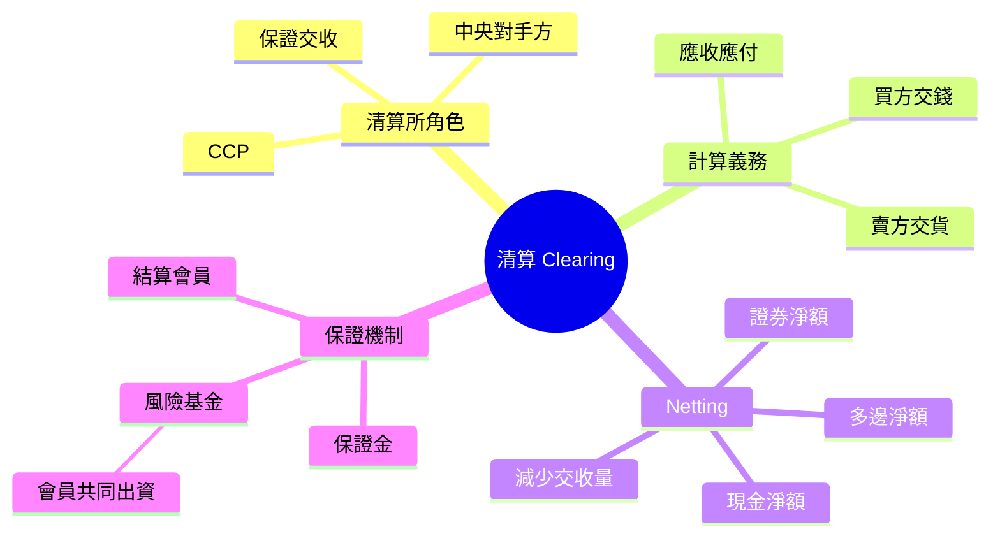

# Module 09: 清算：邊個保證交收

## Knowledge Map

## Learning Objectives

1. 理解 CCP（Central Counterparty 中央對手方）點樣保證交收
2. 認識清算所計算各方應收應付嘅過程
3. 理解 netting 點樣減少交收量
4. 認識保證金同風險基金點樣控制風險

## Real-World Example

陳生買入 1,000 股匯豐，賣方係一間對沖基金。如果基金交唔到貨，陳生點算？

答案：佢唔使擔心。因為 HKEX（Hong Kong Exchanges and Clearing 香港交易所）旗下嘅 CCASS（Central Clearing and Settlement System 中央結算系統）做咗 CCP——佢成為陳生嘅賣方，同時成為基金嘅買方。就算基金違約，CCASS 都會保證交貨俾陳生。

呢個就係清算嘅核心價值：將交易對手風險轉移到受監管、有保證金嘅中央機構。

## Core Content

第一層：清算所嘅角色（CCP）

清算所做三件事：

1. **取代對手方**：CCP 成為所有買方嘅賣方、所有賣方嘅買方
2. **計算義務**：每日計算每個會員嘅應收應付
3. **保證交收**：就算一方違約，CCP 都會履行

> **Think**：CCP 點樣做到保證交收？佢自己錢邊度嚟？

靠保證金（margin）同風險基金。每個結算會員都要按持倉繳保證金，加上會員共同出資嘅風險基金（結算基金）buffer。違約時用呢啲錢去補數。

> **Cloze**: CCP = {中央}對手方；CCASS = HK {中央結算}系統；淨額 {結算} 減少交割次數。
>
> *Answer: 中央 / 中央結算 / 結算*

第二層：清算流程

| 步驟 | 時點 | 事件 |
|------|------|------|
| 1 | T+0 成交 | 交易報送清算所 |
| 2 | T+0 晚 | 清算所計算應收應付 |
| 3 | T+1 | 確認、保證金追收 |
| 4 | T+2 | 交收（貨同錢同時過戶） |

> **Predict**：如果一個會員持倉虧損，保證金唔夠，清算所會點做？

即刻追收 margin（margin call），要求補錢。如果唔補，清算所**有權**強制平倉（liquidate），確保自己唔會損失。

第三層：Netting（淨額結算）

清算所唔會逐筆交收，而係用 netting 將多筆交易淨額化：

| 會員 | 買入 | 賣出 | 淨額 |
|------|------|------|------|
| A | 100 股 | 60 股 | 淨買 40 股 |
| B | 50 股 | 80 股 | 淨賣 30 股 |

Cash netting：只交收淨現金差額，唔係每筆都過數。
Security netting：只交收淨貨，唔係每筆都過貨。

> **Think**：Netting 有咩好處？

減少交收次數、減少結算風險、減少現金需求。原本 100 筆交易可能淨額化做 10 筆交收。

第四層：保證機制

| 機制 | 作用 |
|------|------|
| 保證金（Margin） | 每個會員按持倉繳，覆蓋潛在虧損 |
| 風險基金/結算基金 | 會員共同出資，互相兜底，覆蓋保證金唔夠嘅極端情況 |
| 結算會員 | 只有大機構可以做，有資本要求 |

> **Spot the Mistake**：有人話「清算所保證冇風險」——錯。清算所將風險集中咗，唔係消滅咗。極端情況（例如 2008 金融海嘯）清算所自己都可能受損，所以先要多層保證機制。

## Why This Matters

私人銀行同經紀透過 CCP 交易，大大降低對手方風險。冇 CCP，你要自己查核每個交易對手嘅信用狀況——呢個對散戶同 PB 都不切實際。

Netting 減少交收量，直接影響托管行嘅成本同交收效率。

## Key Takeaways

- CCP 取代對手方，保證交收
- 清算所計算應收應付，用 netting 減少交收量
- 保證金 + 風險基金（結算基金）= 多層保證
- 清算將風險集中，唔係消滅

## Common Misconception

> **Spot the Mistake**：「清算 = 結算」——錯。清算（clearing）係計算義務、確保交收嘅過程，屬中間環節；結算（settlement）係最終錢貨兩訖嘅動作。清算先，結算後。

## Feynman Explain

試下解釋：

1. CCP 點樣將交易對手風險轉移？
2. Netting 點樣減少交收量？舉個數字例子
3. 保證金同風險基金（結算基金）有咩分別？

用合資做生意嘅例子打比方。

## Reframe

你去市場買嘢，唔使理邊個種菜、邊個運輸——市場管理處保證貨品質。CCP 就係金融市場嘅「管理處」，佢保證你收到貨收到錢，唔使自己查每個對手。

## Drill

1. CCP 嘅三個核心功能係咩？
2. Netting 點樣減少交收量？
3. 保證金同風險基金（結算基金）分別點樣運作？
4. 清算同結算嘅先後順序係？
