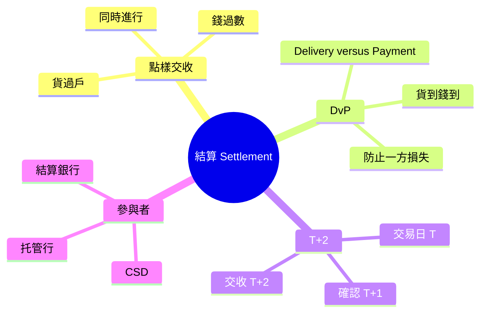
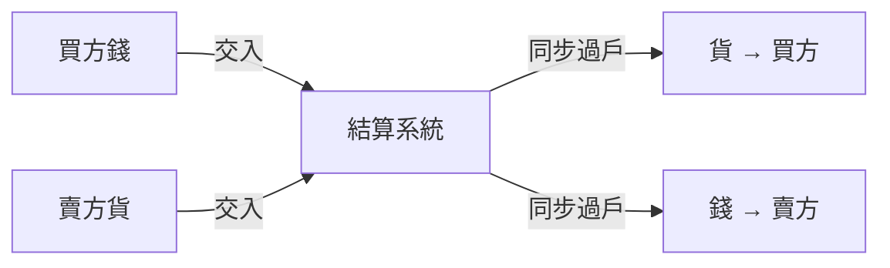
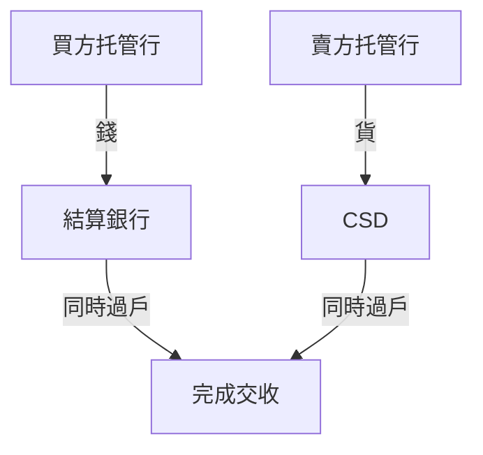

# Module 10: 結算：錢貨兩訖

Est. study time: 1h
Language: yue
Description: settlement 點樣做到錢貨兩訖、DvP 機制同三種模式、T+2 交收流程、CSD 同托管行角色

## Knowledge Map

## Learning Objectives

1. 理解 settlement 點樣做到錢貨兩訖
2. 認識 DvP（券款對付）機制
3. 記住香港 T+2 交收流程
4. 認識 CSD 同托管行喺交收中嘅角色
5. 分辨 SSI 同 settlement instruction

## Real-World Example

陳生喺 10 月 5 日買入 1,000 股匯豐，成交價 HKD 150。成件事唔係 T+2 先開始——托管行事前已經收到指令：

1. **T+0** 成交，經紀發 fill report
2. **T+0晚～T+1** 中台將 allocation instructions 交俾托管行——1,000 股匯豐入陳生個 sub-account（Module 08 講過）
3. **T+1** 托管行按 allocation + SSI（常設結算指示）準備 settlement instruction
4. **T+2** 托管行用佢喺 CSD 嘅戶口做 DvP：
   - 從陳生嘅現金帳戶扣走 HKD 150,000（+ 佣金稅費）
   - 將 1,000 股匯豐過入陳生嘅證券帳戶

同一日，賣方嘅托管行以自己喺 CSD 嘅戶口交貨收錢。成個過程同步進行，冇人會「俾咗錢收唔到貨」——呢個就係 DvP。

分工一句：**經紀負責執行同發指令（fill、allocation）；錢貨過戶係托管行同 CSD 嘅事。**

## Core Content

第一層：結算做咩

結算係生命週期最後一步——錢同貨同時過戶：

| 動作 | 方向 | 結果 |
|------|------|------|
| 貨過戶 | 賣方 → 買方 | 證券轉名 |
| 錢過數 | 買方 → 賣方 | 資金轉移 |

> **Think**：點解唔可以「先俾錢，遲啲先交貨」？

因為有對手方風險——你俾咗錢，對方跑路點算？所以金融市場用 DvP，確保貨到同時錢到。

> **Cloze**: DvP = {貨銀}兩訖；HK T+{2} 由 {trade} date 起計。
>
> *Answer: 貨銀 / 2 / trade*

第二層：DvP（Delivery versus Payment）

DvP 即係「貨銀兩訖」。字面拆開：

- **Delivery**（交貨）：證券過戶
- **Payment**（付款）：資金過數
- **versus**：兩樣綁埋一齊——貨嘅交割以錢嘅交割做條件，反之亦然

核心規則一句：**除非錢到位，貨唔會過戶；除非貨過戶，錢唔會付出。**

點樣做到「同時」？靠中立第三者（CSD/結算系統），唔係買賣雙方直接交收：

1. 買方將錢交俾結算系統（唔係直接俾賣方）
2. 賣方將貨交俾結算系統（唔係直接俾買方）
3. 系統見兩邊都到位，先同步放出——貨過戶俾買方，錢過戶俾賣方

咁樣買賣雙方都唔使直接信對方——大家信結算系統。系統「兩邊扣住、同步放行」，就冇時間差。

三種交收模式：

| 模式 | 運作 | 特點 |
|------|------|------|
| Gross DvP | 逐筆貨錢一一配對 | 最安全，但效率低 |
| Net DvP | 多筆交易先計淨額，再貨錢配對 | 平衡安全同效率 |
| 冇 DvP（本金風險交收） | 一方先交，另一方後交 | 有本金風險——先交嗰方可能收唔返 |

邊個用邊種？**Gross**：英國 CREST 等市場逐筆交收最穩陣，但資金佔用大。**Net**：多數 CCP 股票市場用——HK（CCASS）、US（NSCC）都係。冇 DvP：本金風險，效率優先嘅場景。

香港股票結算用 CCP + **Net DvP**：清算層（Module 09）CCP 先多邊淨額（100 筆 → 淨 10 筆），結算層 CSD 再對淨額做貨銀兩訖——淨錢同淨貨同步過戶。兩層接力，唔係二選一。

> **Predict**：如果買方帳戶錢唔夠，交收會點？

交收失敗（settlement fail）。因為 DvP：錢唔到位，貨就唔會過戶——賣方嘅貨仍然喺賣方度，唔會「freeze」。後果係買方要俾罰息（delayed settlement interest），遲遲唔補錢會被 buy-in（由結算所替補買入）。唔係 margin call——margin call 係保證金帳戶追保，同交收失敗係兩回事。

第三層：T+2 交收流程

| 時點 | 事件 | 參與者 |
|------|------|--------|
| T+0 | 成交、fill report | 經紀 |
| T+0～T+2（法例最遲 T+2） | contract note 發出 | 經紀 |
| T+1 | affirmation、清算計算 | 買賣雙方、清算所 |
| T+1 | 保證金追收 | 結算會員 |
| T+2 | 貨同錢同時過戶 | CSD、托管行 |

> **Think**：T+2 嘅「2」點計？

由交易日（trade date）起計，唔係由確認日起計。T+0 成交，T+1 確認，T+2 交收。週末同公眾假期唔計。

第四層：CSD 同托管行

| 角色 | 職責 |
|------|------|
| CSD（中央證券存管） | 持有證券總帳、執行過戶、同結算系統對接 |
| 托管行（Custodian） | 代客戶持有證券、發 settlement instruction、對帳出單、管 failing |
| 結算銀行 | 處理資金過帳 |

托管行具體做咩：

- **代客收付款**：交收日扣走買方資金、將賣方貨款入賬
- **發 settlement instruction 俾 CSD**：指示幾時過幾多貨
- **對帳、出月結單**：核對持倉同交易，俾客户睇
- **Failing 管理**：追收罰息、處理 buy-in、跟進交收失敗

**SSI（Standing Settlement Instructions，常設結算指示）**：預先登記嘅收付款帳戶指引——邊個戶口收錢、邊個戶口交貨。交易前就設好，交收日唔使重新填，減錯帳風險。機構單多客多戶口，SSI 特別重要（07 講嘅 ALERT 平台就係管 SSI）。

SSI 同 settlement instruction 分別：SSI 係「常設資料」（呢個客/呢個對手嘅戶口係邊）；settlement instruction 係「呢單嘅指令」（呢單交幾多、幾時交）。

> **Spot the Mistake**：有人話「托管行就係 CSD」——錯。CSD 係中央存管機構（如香港嘅 CCASS），持有證券總帳、執行過戶；托管行係代客户持有嘅中介，交收日代客收付款、發 settlement instruction 俾 CSD、對帳出單，佢嘅持倉記喺 CSD 入面。兩者係唔同層級。

## Why This Matters

結算係真金白銀嘅最後關卡。交收失敗會產生罰息、buy-in 風險、聲譽損害。PB 同經紀嘅托管行效率直接影響客户體驗。

DvP 確保冇人會「俾咗錢收唔到貨」，係金融市場信任嘅基石。

## Key Takeaways

- DvP = 貨同錢交割綁埋一齊，靠結算系統同步過戶
- 香港 T+2：T+0 成交 → T+1 對數清算 → T+2 交收
- CSD 持有證券總帳；托管行代客户持有、發 settlement instruction、對帳
- SSI = 常設結算指示，預先登記戶口資料；同 settlement instruction（呢單嘅指令）唔同
- 交收失敗有罰息、buy-in 風險，唔係 margin call

## Common Misconception

> **Spot the Mistake**：「T+2 代表三日後交收」——錯。T+2 係兩個交易日後。週五成交，下週二交收（週六日唔計）。如果遇公眾假期會順延。

## Feynman Explain

試下解釋：

1. DvP 點樣防止對手方風險？點解要靠結算系統？
2. CSD 同托管行有咩分別？托管行交收日做咩？
3. SSI 同 settlement instruction 有咩分別？
4. 交收失敗會有咩後果？

用網購「貨到付款」嘅例子打比方。

## Reframe

你網購用「貨到付款」——送貨員同時收錢俾貨，你唔使擔心俾咗錢貨唔到。DvP 就係金融版嘅貨到付款，只不過過戶嘅係股票同現金。

## Drill

1. DvP 嘅核心係咩？點樣做到「同時」？
2. T+2 嘅「2」點計？週五成交幾時交收？
3. CSD 同托管行嘅分別？托管行交收日做咩？
4. SSI 同 settlement instruction 分別？
5. 交收失敗會有咩後果？
