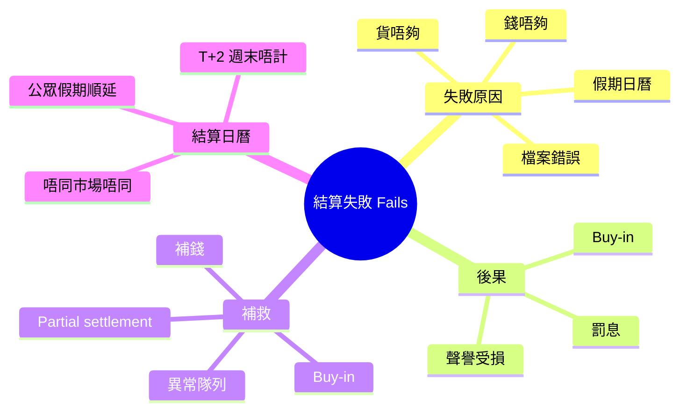
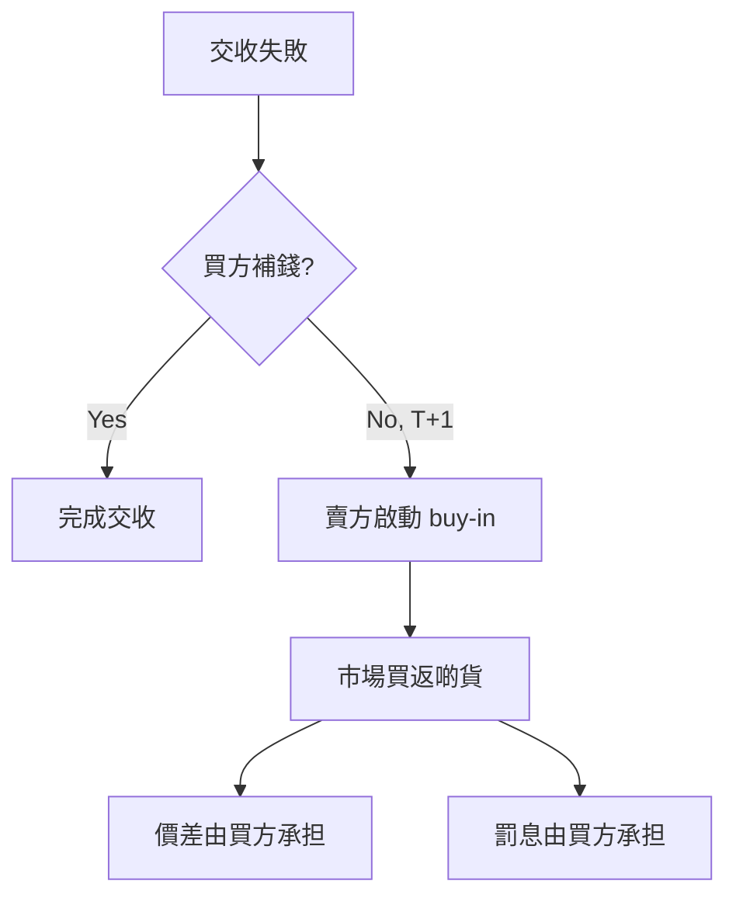

# Module 11: 結算失敗同補救

## Knowledge Map

## Learning Objectives

1. 認識 settlement fail 嘅常見原因
2. 理解 buy-in 點樣強制完成交收
3. 記住結算日曆對交收日嘅影響
4. 認識 partial settlement 點樣處理

## Real-World Example

陳生買入 10,000 股，交收日佢嘅現金帳戶得 HKD 1,400,000，但要俾 HKD 1,500,000+費用。錢唔夠 → settlement fail。

經紀即刻通知陳生補錢。如果 T+1 都未補，賣方可以啟動 buy-in——強制喺市場買返啲貨交俾陳生，價錢高過合約價嘅部分由陳生承担。

同時，經紀會向陳生收罰息（buy-in penalty），因為佢違返交收義務。

## Core Content

第一層：Settlement Fail 嘅原因

| 原因 | 例子 | 頻率 |
|------|------|------|
| 錢唔夠 | 現金帳戶不足 | 最常見 |
| 貨唔夠 | 證券帳戶冇貨（賣方） | 常見 |
| 檔案錯誤 | 帳戶號錯、代號錯 | 中等 |
| 日曆唔同 | 跨市場假期唔同 | 少見但複雜 |

> **Think**：邊個會「錢唔夠」？PB 唔係好有錢咩？

PB 客户都可能因為市場大跌、資金未到位、或者指令延遲而暫時錢唔夠。唔係「窮」，係「時間差」。

> **Cloze**: fail 原因：冇{現金}、冇{證券}、檔案錯誤、結算日曆唔同；補救 = {buy-in}。
>
> *Answer: 現金 / 證券 / buy-in*

第二層：Buy-in（強制買入）

Buy-in 係賣方嘅補救權利：

| 項目 | 說明 |
|------|------|
| 觸發 | 交收日未交收 + 寬限期後 |
| 動作 | 賣方市場買貨交俾買方 |
| 代價 | 價差 + 罰息由違約方承担 |

> **Predict**：Buy-in 發生時市價升咗 5%，邊個蝕？

買方（違約方）。佢要以更高市價買返啲貨，價差自己吞。所以交收失敗嘅代價好大。

第三層：結算日曆（Settlement Calendar）

交收日受日曆影響：

| 情況 | 交收日 |
|------|--------|
| 週一成交 | 週三 |
| 週五成交 | 下週二 |
| 週四成交 + 週五假期 | 下週二 |
| 跨市場交易 | 兩邊日曆都要啱 |

> **Think**：點解跨市場交易特別容易 fail？

因為唔同市場假期唔同。例如香港放假但美國唔放，交收日計算會出錯，一邊做到一邊做唔到，變成 fail。

第四層：Partial Settlement（部分交收）

有時候可以部分交收：

| 情況 | 處理 |
|------|------|
| 錢唔夠買 10,000 股 | 先交收 8,000 股，剩低 2,000 股 fail |
| 貧唔夠交 5,000 股 | 先交 3,000 股，剩低 fail |

部分交收減少雙方損失，但未交收部分仍要跟進。

> **Spot the Mistake**：有人話「fail 唔緊要，拖下就冇事」——錯。Fail 會累積罰息、觸發 buy-in、影響經紀同托管行嘅 KPI、最終影響客户關係。必須即刻處理。

## Why This Matters

私人銀行客户嘅交收失敗會直接影響客戶體驗——客户會問「點解我啲貨未到」。經紀嘅 fail rate 更係監管關注指標。

了解 fail 原因同補救，可以幫你預防問題（例如確保交收日前資金到位）。

## Key Takeaways

- Fail 常見原因：錢唔夠、貨唔夠、檔案錯、日曆唔同
- Buy-in：賣方強制買貨，價差+罰息由違約方吞
- 結算日曆影響交收日，跨市場特別易錯
- Partial settlement 減少損失，但剩低部分仍要跟進

## Common Misconception

> **Spot the Mistake**：「T+2 就係三日後」——錯。T+2 係兩個交易日後，週末同公眾假期唔計。週五成交下週二交收。遇假期順延，跨市場要睇兩邊日曆。

## Feynman Explain

試下解釋：

1. Buy-in 點樣運作？邊個承担價差？
2. 點解跨市場交易特別容易 settlement fail？
3. Partial settlement 有咩好處？

用「借錢買嘢但錢唔夠」嘅例子打比方。

## Reframe

你訂咗嘢但交收日錢唔夠，店主話：「我幫你喺市場買返，價高咗你自己吞，仲要收你滯納金。」呢個就係 buy-in + 罰息。交收失敗嘅代價就係咁直接。

## Drill

1. 四個 settlement fail 原因？
2. Buy-in 點樣運作？
3. 週五成交幾時交收？
4. Partial settlement 適用咩情況？
