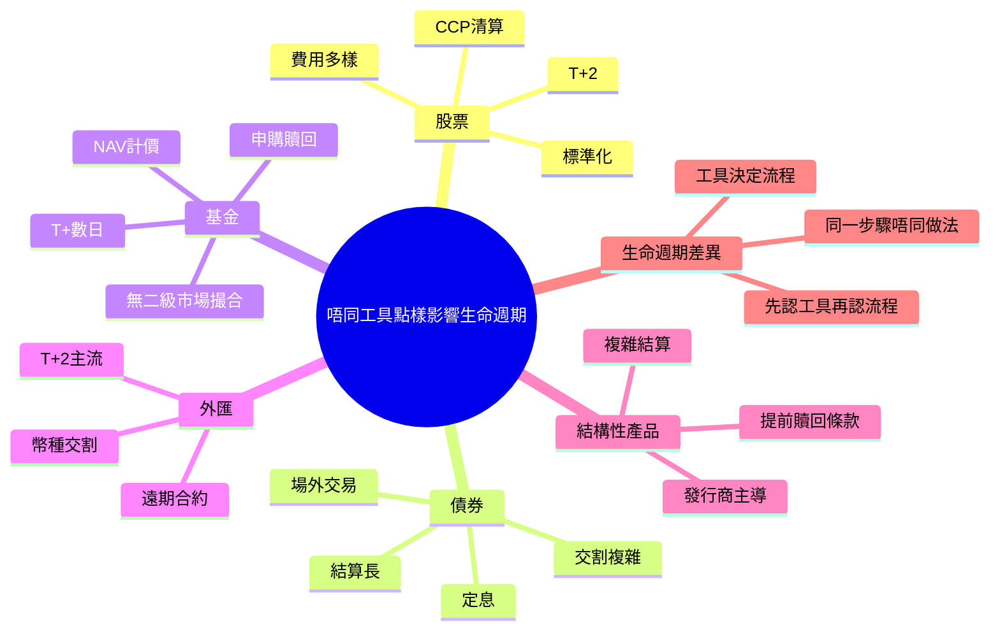

# Module 12: 唔同工具點樣影響生命週期

## Knowledge Map

## Learning Objectives

- 認出股票、債券、基金、外匯、結構性產品生命週期主要差異
- 明白工具點樣改變執行、配對、清算、結算每個步驟
- 記住唔同工具結算日同交割方式
- 理解點解基金結算日同股票唔同

## Real-World Example

同一個客，星期一落單：

- **股票**：星期一成交，T+2 星期三錢貨兩訖
- **基金**：星期一下單，基金公司星期二先確認份數，最快星期四（T+3）先過戶
- **債券**：場外談好價，可能要等對手方文件齊先交割

同一個客、同一個經紀，三種工具三條時間線。

## Core Content

### 股票：標準化流程嘅參考點

股票係生命週期嘅「原版」。前幾學模講嘅執行、配對、CCP 清算、T+2 DvP，全部以股票為藍本。

> **Think**: 點解教科書用股票做例子，唔用基金？
>
> *Answer: 股票流程最標準化：有交易所、有 CCP、有 CCASS、有統一結算日。其他工具係呢個骨架上改。*

> **Cloze**: 記憶框架：工具 {決定} 流程；股票 T+2、基金 T+{數日}、外匯主流 T+2。
>
> *Answer: 決定 / 數日*

### 債券：場外交易，流程唔一樣

債券多數喺場外（OTC）交易，冇統一撮合平台。

| 步驟 | 股票 | 債券 |
|------|------|------|
| 執行 | 交易所撮合 | 電話/平台議價 |
| 配對 | 系統自動撮合 | 雙方各自確認 |
| 清算 | CCP 擔保 | 多數冇 CCP，對手方風險 |
| 結算 | T+2 DvP | 見合約，可能 T+2 或更長 |

> **Think**: 債券冇 CCP，邊個承擔對手方風險？
>
> *Answer: 買賣雙方自己。所以債券交易更靠對手方信用，大行會做信用限額管理。*

### 基金：申購贖回，唔係撮合

基金冇二級市場撮合。你同基金公司做，唔係同另一個投資者做。

**基金生命週期：**
1. 投資者落單（申購或贖回）
2. 基金公司確認
3. 按 NAV（資產淨值）計價
4. 份數過戶 / 資金過賬
5. 結算日通常 T+數日，唔係固定 T+2

> **Predict**: 賣基金之後幾時收到錢？
>
> *Answer: 多數 T+3 至 T+10，視乎基金類型。貨幣基金快，股票基金慢。唔可以照股票 T+2 估。*

### 外匯：幣種交割

外匯交易同時交割兩種貨幣：你賣港幣買美元，交割 = 港幣出去、美元入嚟。

- 主流結算：T+2
- 主要貨幣即日交割（T+0）都常見
- 遠期外匯（forward）：未來某日按約定匯率交割

> **Think**: 點解外匯交割要處理兩種貨幣？
>
> *Answer: 外匯本質係貨幣交換，一邊過數一邊收數。結算風險 =兩邊唔同時完成（Herstatt 風險）。*

### 結構性產品：發行商主導

結構性產品（如結構性票據、窩輪）生命週期由發行商主導：

- **上市前**：發行商設計、定價、發行
- **交易中**：部分有二級市場（窩輪），部分要問發行商
- **到期**：發行商按條款支付（可能有提前贖回條款）
- **結算**：跟產品條款，複雜過股票

> **Think**: 窩輪（warrant）邊個負責結算？
>
> *Answer: 發行商（通常是投行）。到期或行權時發行商對投資者支付，唔係 CCP 撮合對手。*

### 一句話總結差異

| 工具 | 執行 | 清算 | 結算 |
|------|------|------|------|
| 股票 | 交易所 | CCP | T+2 DvP |
| 債券 | 場外議價 | 多數冇 CCP | 合約定 |
| 基金 | 申購贖回 | 基金公司 | T+數日 |
| 外匯 | 平台/銀行 | 多數冇 CCP | T+2，雙幣交割 |
| 結構性產品 | 發行商/交易所 | 視乎產品 | 條款定 |

## Why This Matters

私人銀行客人組合通常多種工具混合。客人問「我賣咗幾時收到錢」，答案唔係一個數：股票 T+2、基金 T+5、債券唔知要問。搞錯工具對應嘅流程，就會錯估現金流、誤導客人。

## Key Takeaways

- 股票係標準流程，其他工具喺骨架上改
- 債券場外、多數冇 CCP，對手方風險自己扛
- 基金申購贖回 + NAV 計價，結算 T+數日
- 外匯雙幣交割，主流 T+2
- 結構性產品發行商主導，條款複雜

## Common Misconception

**誤解：** 所有產品都係 T+2 結算。
**正確：** 只有主流股票同部分產品係 T+2。基金 T+數日，債券見合約，外匯視乎幣種。問清楚工具再答。

## Spot the Mistake

一個新 RM 同客人講：「你隻基金聽日就 T+2 收到錢，同股票一樣。」

錯喺邊？
**Answer:** 基金唔係 T+2 撮合結算。基金係申購贖回制，結算日通常 T+3 至 T+10。RM 用咗股票時間線套落基金，會誤導客人現金流。

## Feynman Explain

試用一句話解釋俾朋友聽：「點解賣基金同賣股票收錢時間唔同？」
你嘅解釋應該包含：基金係申購贖回制、NAV 計價、結算日較長。

## Reframe

唔好記「每種工具嘅規則」。記「工具決定流程」：先問客人買賣咩工具，再套對應嘅執行 → 配對 → 清算 → 結算。同一條生命週期骨架，唔同工具換唔同零件。

## Drill

1. 寫出股票、基金、債券三者結算方式一句話差異。
2. 點解外匯結算有 Herstatt 風險？一句話。
3. 窩輪到期邊個支付？點解？
