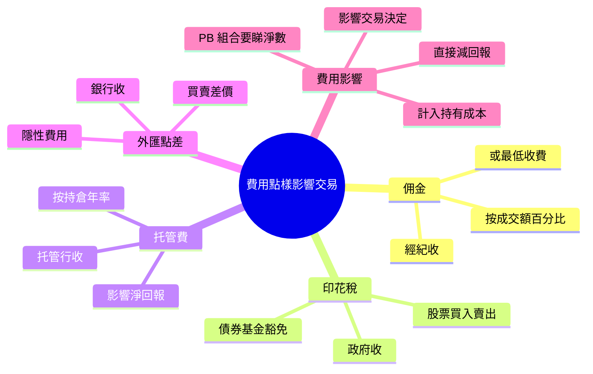

# Module 13: 費用點樣影響交易

## Knowledge Map

## Learning Objectives

- 認出交易同持有相關主要費用
- 明白每項費用由邊個收、幾時收
- 計算費用點樣直接減低淨回報
- 理解費用點樣影響交易決定（尤其高換手策略）

## Real-World Example

客人買入 100,000 港元股票：

| 費用 | 率 | 金額 |
|------|-----|------|
| 佣金 | 0.25% | 250 港元 |
| 印花稅 | 0.1% | 100 港元 |
| 交易徵費等 | ~0.005% | 5 港元 |

買入成本即刻多咗約 355 港元。賣出又要俾佣金 + 印花稅。一買一賣往返成本接近 0.7%。

## Core Content

### 費用點解重要

交易費用唔係「細數」。高換手策略一年交易 50 次，每次往返 0.7%，費用累積食掉 35% 本金。私人銀行組合要睇**淨回報**，唔係毛回報。

> **Think**: 點解兩隻回報一樣嘅基金，收費高嗰隻唔吸引？
>
> *Answer: 收費直接從資產扣，淨回報低。複利下差距越滾越大。*

> **Cloze**: 往返費用 ≈（佣金 0.25% + 印花稅 0.1%）× 2 ≈ {0.7}%；淨回報 = 總回報 − {費用}。
>
> *Answer: 0.7 / 費用*

### 佣金（Commission）

經紀收嘅服務費。

- 按成交額百分比（如 0.25%）
- 或設最低收費（如最低 50 港元）
- 買賣兩邊通常都收
- 可議價（尤其機構/高成交量）

### 印花稅（Stamp Duty）

政府收嘅稅，唔係經紀費。

- 香港股票：買入賣出各 0.1%（以實際為準）
- 部分債券、基金可能豁免
- 同交易量掛鉤，無法議價

> **Think**: 印花稅邊個袋？
>
> *Answer: 政府。唔係經紀佣金，係法定稅項。經紀只係代收。*

### 托管費（Custody Fee）

持倉期間收嘅費用，影響**持有成本**。

- 按持倉市值年率（如 0.1% p.a.）
- 逐日/逐月計算，由資產扣
- 外幣持倉可能另收貨幣兌換或保管費
- 冇交易都要俾

### 外匯點差（FX Spread）

換匯時嘅隱性費用。

- 銀行報買賣價：買入價 / 賣出價之間嘅差
- 外幣存款、外幣買賣都有
- 睇似「冇手續費」，實際已計入點差

> **Predict**: 客人話「換匯冇收費」，實際費用喺邊？
>
> *Answer: 喺買賣點差。銀行低價買入、高價賣出，差價就係利潤。*

### 費用點樣影響交易決定

| 費用類型 | 影響 |
|----------|------|
| 佣金 + 印花稅 | 提高往返成本 → 減少短線炒賣 |
| 托管費 | 提高持有成本 → 長持都要計 |
| FX 點差 | 外幣交易成本 → 影響配置決定 |

高費用環境下，買賣越頻密越蝕。呢個係「費用拖累」（fee drag）。

### PB 組合視角

私人銀行組合收費層級多：產品管理費 + 托管費 + 交易費 + 可能嘅表現費。客人淨回報 = 總回報 − 全部費用。RM 要識計、識解釋。

## Why This Matters

客人見到「回報 8%」好開心，但扣晒費用可能淨得 6%。唔識費用結構，就冇辦法俾準確建議，亦容易誤導客人預期。

## Key Takeaways

- 佣金經紀收、印花稅政府收、托管費持倉收、FX 點差銀行收
- 往返成本 =（佣金 + 印花稅）× 2
- 托管費影響持有成本，冇交易都要俾
- 高換手 → 費用拖累放大
- 要睇淨回報，唔係毛回報

## Common Misconception

**誤解：** 「冇佣金就冇交易成本。」
**正確：** 印花稅、其他徵費、FX 點差都係成本。零佣金平台都有印花稅同點差。

## Spot the Mistake

一個 RM 同客人講：「我哋幫你搵到隻零佣金平台，交易完全免費。」

錯喺邊？
**Answer:** 零佣金唔等於零成本。印花稅、結算費、FX 點差依然存在。RM 漏咗非佣金成本，會誤導客人決策。

## Feynman Explain

試用超市購物解釋：佣金係「店員幫你結帳嘅小費」，印花稅係「政府購物稅」，托管費係「寄存櫃租」。一句話講晒三者分別。

## Reframe

唔好當費用係「額外嘢」。費用係交易嘅一部分：落單前就要計入成本，做決定時要計淨回報。費用思維 = 資深玩家思維。

## Drill

1. 寫出股票往返交易四項主要費用。
2. 100,000 港元交易，佣金 0.25% + 印花稅 0.1%，買賣一次總費用幾多？
3. 點解托管費對長線投資者都重要？
