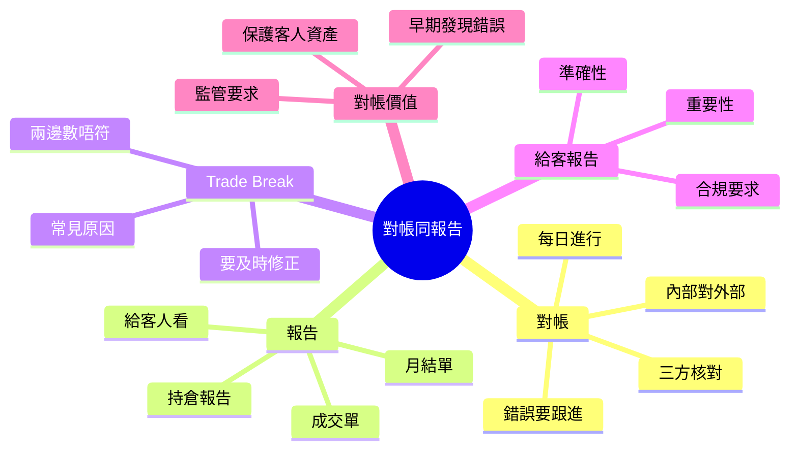

# Module 14: 對帳同報告

## Knowledge Map

## Learning Objectives

- 明白對帳係三方核對（自己、對手、清算所）
- 認出 Trade Break 嘅常見原因同處理
- 分別成交單、月結單、持倉報告嘅用途
- 理解對帳點樣保護客人資產同合規

## Real-World Example

星期一，中後台對帳發現：

- 公司記錄：客人買入 10,000 股匯豐 @ 60.00
- 結算所記錄：10,000 股 @ 60.10

價錢差 0.10 = 1,000 港元差額。呢個係 **trade break**。要即刻查：係咪輸入錯？係咪另一單成交搞錯？

## Core Content

### 對帳係咩

對帳（reconciliation）= 三方核對：

| 方 | 記錄 |
|----|------|
| 自己（經紀/銀行） | 內部帳 |
| 對手方 | 對方帳 |
| 清算所 / 結算系統 | 官方帳 |

三方數目一致先算數。唔一致 = break，要查要修正。

> **Think**: 點解要對三次，淨係自己內部對唔得？
>
> *Answer: 內部帳可能兩邊都錯。對手方同清算所係獨立第三方，先可信。*

> **Cloze**: 對帳三方：{自己}、對手、{清算所}；發現 trade break 第一步查 {原始成交單}。
>
> *Answer: 自己 / 清算所 / 原始成交單*

### 對帳幾時做

- **每日對帳**（daily reconciliation）：開市前完成昨日對帳
- 結算後對帳：確認錢貨到位
- 月末總對帳：出月結單前

### Trade Break：兩邊數唔符

| 常見原因 | 例子 |
|----------|------|
| 輸入錯誤 | 手數打錯 1,000 → 10,000 |
| 時點差異 | 一邊記咗，一邊未記 |
| 價錢差異 | 成交價抄錯 |
| 漏記 | 一邊做咗，一邊冇記錄 |

> **Predict**: 發現 trade break，第一步做咩？
>
> *Answer: 查證邊邊錯。對返原始成交單（fill report）同系統記錄，搵出差異來源，再修正。*

### 報告類型

| 報告 | 用途 | 受眾 |
|------|------|------|
| 成交單（contract note） | 法律交易證明，列明費用 | 客人 |
| 月結單（statement） | 月度帳戶總覽：交易、持倉、結餘 | 客人 |
| 持倉報告 | 目前持倉明細 | 客人/RM |
| 對帳報告 | 內部核對結果 | 中後台 |

### 給客人嘅報告重要性

- **準確性**：錯數會誤導客人，甚至觸發投訴
- **及時性**：客人要睇最新帳
- **合規**：監管要求定期提供帳戶報告
- **解釋**：費用明細要清楚，客人先明淨回報

> **Think**: 月結單點解要列明所有費用？
>
> *Answer: 合規要求 + 客人知情權。客人要睇到佣金、稅費、托管費，先計到淨回報。*

### 對帳嘅價值

1. **早期發現錯誤**：每日對帳，錯數唔會累積
2. **保護客人資產**：錯帳可能令客人損失
3. **合規要求**：監管機構要求定期對帳
4. **信心基礎**：帳目準確，客人才信你

## Why This Matters

對帳係中後台核心工作。前端成交好忙，但帳目唔對，最終受損係客人同公司。私人銀行對帳要求尤其嚴格，因為牽涉客戶資產隔離。

## Key Takeaways

- 對帳 = 自己 + 對手 + 清算所三方核對
- Trade Break = 兩邊數唔符，常見於輸入錯、漏記、價差
- 成交單係法律文件，月結單係帳戶總覽
- 每日對帳防止錯誤累積
- 對帳保護客人資產 + 合規必須

## Common Misconception

**誤解：** 「對帳係會計部門嘅事，前台唔使理。」
**正確：** 對帳結果會影響客人帳戶。前台要識讀對帳報告、識回應客人關於帳目差異嘅查詢。

## Spot the Mistake

一個 ops 人員發現 trade break，佢直接改內部帳，令兩邊「一致」，冇查邊邊啱。

錯喺邊？
**Answer:** 冇查證就改數。可能改錯方向，將啱嗰邊改成錯。正確做法：查原始成交單，搵出邊邊錯，修正錯誤嗰邊。

## Feynman Explain

試用銀行存摺解釋：你記帳話存咗 5,000，銀行記錄 500，對帳就要查邊個啱。對帳就係「自己帳 vs 銀行帳」嘅核對。

## Reframe

對帳唔係「事後檢查」，係「資產保護機制」。每一筆交易背後，有三方記錄要對齊。識對帳，先識保證帳目可信。

## Drill

1. 寫出對帳嘅三方係邊三方。
2. 列出三個 trade break 常見原因。
3. 成交單同月結單有咩分別？
