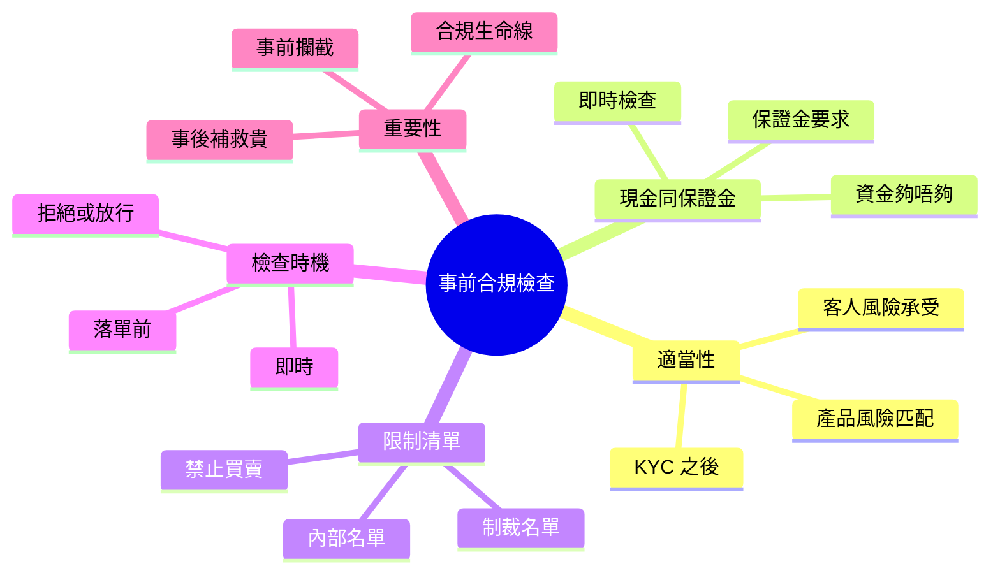

# Module 15: 事前合規檢查

## Knowledge Map

## Learning Objectives

- 認出三類事前檢查：適當性、資金/保證金、限制清單
- 明白每類檢查嘅目的同時機
- 理解點解事前攔截好過事後補救
- 記住 KYC 同適當性嘅關係

## Real-World Example

客人落單買入 500 萬港元高風險結構性產品。

系統即刻查：

1. **適當性**：客人風險承受係保守型，產品係高風險 → 不匹配，攔截
2. **資金**：帳戶現金 300 萬 → 唔夠，攔截
3. **限制**：客人所在地區唔準買此類產品 → 攔截

三關都過唔到，訂單根本出唔到去。

## Core Content

### 事前 vs 事後

事前檢查（pre-trade checks）喺訂單送出前執行。過唔到，訂單唔會去交易所。

> **Think**: 點解要事前攔，唔係成交後先處理？
>
> *Answer: 成交後要取消、賠償、可能違規罰款。事前攔截成本近乎零，事後補救又貴又有法律風險。*

> **Cloze**: 三類事前檢查：{適當性}、資金保證金、{限制清單}；保證金購買力 = 持倉 × {保證金}比例。
>
> *Answer: 適當性 / 限制清單 / 保證金*

### 三類事前檢查

| 類型 | 檢查咩 | 不通過結果 |
|------|--------|------------|
| 適當性（suitability） | 客人風險承受 vs 產品風險 | 拒絕下單 |
| 現金/保證金 | 資金夠唔夠、保證金要求 | 拒絕或要求補倉 |
| 限制清單 | 禁止名單、制裁、內部限制 | 拒絕下單 |

### 適當性（Suitability）

KYC（認識你嘅客人）之後，要確保產品適合客人。

- 客人風險承受能力（保守/穩健/進取）
- 投資目標、期限
- 產品風險級別
- 兩者要匹配

> **Predict**: 保守型客人想買高風險衍生工具，結果？
>
> *Answer: 不匹配，系統攔截。RM 要解釋風險，或建議更適合產品。強行推銷違規。*

### 現金同保證金檢查

- **現金帳戶**：買入金額 + 費用 ≤ 帳戶現金
- **保證金帳戶**：可用購買力夠唔夠；保證金維持率夠唔夠
- 資金唔夠 → 訂單被拒，或觸發保證金追繳

> **Think**: 保證金帳戶「購買力」係咩？
>
> *Answer: 可以用嚟買嘢嘅額度，基於持倉市值 × 保證金比例。唔係帳戶現金總額。*

### 限制清單（Restrictions）

| 清單類型 | 例子 |
|----------|------|
| 制裁名單 | 地區/實體制裁，禁止交易 |
| 內部限制 | 公司政策禁止某類產品 |
| 客人限制 | 客人自己設定唔准買某類 |
| 監管限制 | 法規禁止向某類客戶銷售 |

過唔到限制清單 = 絕對唔可以落單，冇得商量。

### 檢查時機

- **落單前即時**（real-time pre-trade check）
- 訂單喺系統排隊前完成檢查
- 任何一關不過，訂單拒絕或擱置

### 重要性

1. **事前攔截**：成本低，無法律後果
2. **合規生命線**：監管要求事前檢查
3. **保護客人**：避免唔適合嘅投資
4. **保護公司**：避免違規罰款

## Why This Matters

私人銀行合規要求尤其嚴格。客人投訴「我唔應該買到呢隻產品」，第一時間查嘅就係事前檢查有冇做到。做齊事前檢查，先保護到客人同自己。

## Key Takeaways

- 事前檢查三類：適當性、資金/保證金、限制清單
- 適當性 = KYC 之後，風險承受 vs 產品風險匹配
- 資金唔夠或保證金唔夠 → 訂單被拒
- 限制清單過唔到 = 絕對唔可以落單
- 事前攔截成本低，事後補救貴

## Common Misconception

**誤解：** 「客人自己想買，我就幫佢落單，唔使理適唔適合。」
**正確：** 適當性係合規要求，唔理客人意願。明知唔適合仲落單，違規兼可能要賠償。

## Spot the Mistake

一個 RM 知道客人風險承受係保守型，但客人好想買高風險產品。RM 覺得「客人自己負責」，直接落單。

錯喺邊？
**Answer:** 適當性檢查係 RM 合規責任，唔可以轉嫁客人。明知不匹配仲落單，違規。應攔截並解釋，或建議適合產品。

## Feynman Explain

試用航空公司安檢解釋：事前檢查 = 登機前安檢，過唔到唔准上機。事後補救 = 飛到先發現問題，代價大。事前攔截永遠好過事後處理。

## Reframe

事前檢查唔係「阻住做生意」，係「保護所有人」嘅閘口。客人、RM、公司三贏。識用呢個閘口，先係合規專業。

## Drill

1. 寫出三類事前檢查同各自目的。
2. 適當性點解喺 KYC 之後先做？
3. 資金帳戶同保證金帳戶嘅資金檢查有咩分別？
