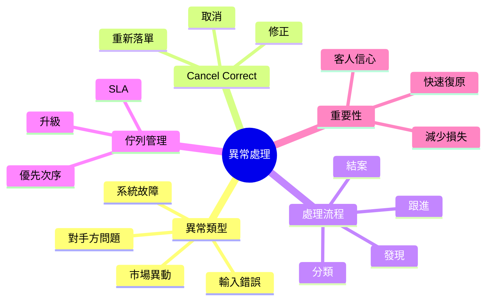

# Module 16: 異常處理

## Knowledge Map

## Learning Objectives

- 認出常見交易異常類型
- 明白 cancel-correct 流程幾時用
- 理解異常處理嘅基本步驟
- 記住異常處理嘅速度點樣影響損失

## Real-World Example

中後台朝早發現：客人單顯示買入 10,000 股，但成交單只顯示 1,000 股。多咗 9,000 股冇成交記錄。

呢個係異常。要查：係輸入錯？係系統截斷？定係部分成交未記錄？

## Core Content

### 異常係咩

異常（exception）= 偏離正常流程嘅情況。交易生命週期中，任何一步都可能出異常。

| 異常類型 | 例子 |
|----------|------|
| 輸入錯誤 | 手數、價錢打錯 |
| 系統故障 | 下單系統當機、數據延遲 |
| 對手方問題 | 對手方唔確認、唔交收 |
| 市場異動 | 極端波動、停牌 |

> **Think**: 異常點解要即時處理？
>
> *Answer: 拖得越耐，損失越大（價差擴大、違規風險、客人不滿）。*

> **Cloze**: 異常流程：{發現} → {分類} → 跟進 → 結案；Cancel-correct 次序 Cancel → {Correct} → 重新落單。
>
> *Answer: 發現 / 分類 / Correct*

### Cancel-Correct 流程

當發現訂單有錯，要取消或修正：

1. **Cancel**（取消）：撤回錯誤訂單
2. **Correct**（修正）：改正確資料
3. **重新落單**：用正確資料再落

> **Predict**: 客人單價錢打錯（100 打成 1,000），已經部分成交。點處理？
>
> *Answer: 先 cancel 未成交部分，correct 價錢，再重新落單。已成交部分可能要另作處理（如反向交易）。*

### 異常處理流程

| 步驟 | 做咩 |
|------|------|
| 發現 | 對帳、系統警報、客人投訴 |
| 分類 | 邊類異常？嚴重性？ |
| 跟進 | 查證、修正、通知相關方 |
| 結案 | 記錄、防止再犯 |

### 佇列管理（Queue Management）

異常會入隊列，按優先次序處理：

- **高優先**：影響結算、大額、客人投訴
- **中優先**：一般輸入錯誤
- **低優先**：格式問題、非緊急

**SLA**（Service Level Agreement）= 處理時限。例如高優先異常 2 小時內處理。

> **Think**: 點解高優先異常要快過低優先？
>
> *Answer: 高優先異常影響結算同客人，拖耐會放大損失。低優先可以等。*

### 速度同損失嘅關係

| 處理速度 | 結果 |
|----------|------|
| 快 | 損失小、客人信心保得住 |
| 慢 | 價差擴大、違規風險、客人不滿 |

異常處理速度 = 直接影響公司同客人利益。

### 升級（Escalation）

隊列處理唔到，要升級：

- 超 SLA 未處理 → 升級上級
- 牽涉合規/法律 → 升級合規部
- 系統性問題 → 升級 IT

## Why This Matters

交易生命週期複雜，異常必然出現。識處理異常，先係成熟嘅中後台。私人銀行對異常尤其敏感，因為直接牽涉客人資產。

## Key Takeaways

- 異常 = 偏離正常流程，要即時處理
- Cancel-correct：取消 → 修正 → 重新落單
- 處理流程：發現 → 分類 → 跟進 → 結案
- 佇列按優先次序，有 SLA
- 速度直接影響損失大小

## Common Misconception

**誤解：** 「異常好罕見，唔使特別準備。」
**正確：** 異常係常態，每日都有。有流程、有隊列、有 SLA，先處理得快。

## Spot the Mistake

一個 ops 人員發現異常，佢自己改咗數就算，冇記錄、冇通知相關方。

錯喺邊？
**Answer:** 冇記錄就冇辦法防止再犯，冇通知就可能影響其他部門。異常處理要有完整流程：修正 + 記錄 + 通知 + 防再犯。

## Feynman Explain

試用快遞解釋：快遞送錯地址，你要聯絡快遞公司 cancel 送錯嗰單、correct 地址、重新派送。異常處理就係呢個流程嘅交易版。

## Reframe

異常唔係「失敗」，係「發現問題嘅機會」。每一次異常處理，都係完善流程嘅機會。識處理異常，先係專業。

## Drill

1. 寫出四種常見交易異常類型。
2. Cancel-correct 流程三步係咩？
3. 點解高優先異常要快過低優先？
