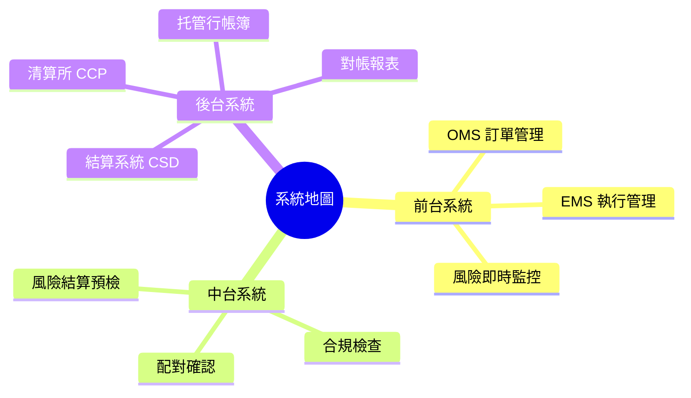
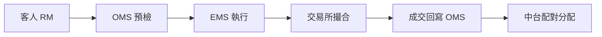
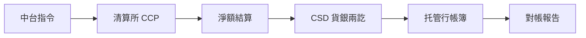

# Module 17: 系統地圖：OMS 到托管行

Est. study time: 1h
Language: yue
Description: 由 OMS/EMS 起，經交易台、清算所、CSD 到托管行——前中後台系統點樣串連一單交易。

## Knowledge Map

---

## Learning Objectives (maps to course CILOs)
- 畫出一單交易由 OMS 到托管行嘅系統流程
- 分清楚前中後台各系統負責乜、交接點喺邊

---

## Real-World Example

RM 為客人落單：OMS 收到訂單，即時做預檢（資金夠唔夠、有冇限制），過咗先送去交易台。交易台用 EMS 揀場執行，成交回寫 OMS。中台收成交後做配對同分配，傳俾清算所。清算所 CCP 清算完，CSD 做貨銀兩訖交割，托管行更新客人帳簿。每一環有獨立系統，斷咗一環單就停。

> **Think**: 點解 OMS 收到單唔可以直接送去交易所？
>
> *Answer: OMS 要先做預檢（資金/保證金/限制清單），過唔到就唔應該流去市場——事前攔截成本最低。*

---

## Core Content

### 前中後台分工

| 層 | 負責 | 主要系統 | 交接點 |
|---|---|---|---|
| 前台 | 落單、執行 | OMS、EMS | 成交流入中台 |
| 中台 | 風險、配對、分配、合規 | 風險系統、配對引擎、CTM（機構 affirmation 平台） | 清算指令傳後台 |
| 後台 | 清算、交割、帳簿、對帳 | 清算所、CSD、托管系統 | 對帳報告回饋 |

> **Think**: 風險監控屬於邊個台？點解唔擺前台？
>
> *Answer: 中台。前台想成交，中台要獨立制衡——自己監察自己冇意義。*

### 訂單流：由 OMS 到成交

OMS（Order Management System）管全張單嘅一生：落單、修改、狀態追蹤。EMS（Execution Management System）專注點樣執行得平——揀邊個場、幾時切大單。

> **Predict**: 成交後第一個更新嘅系統係邊個？
>
> *Answer: OMS——單嘅狀態由「已落單」變「已成交」，中台先有數可配。*

### 清算交割鏈

清算所 CCP 保證交收（取代對手方風險）；CSD 持中央帳簿做貨銀兩訖；托管行喺 CSD 有戶口，再按客人分帳。

> **Think**: CSD 同托管行邊個「擁有」股票？
>
> *Answer: CSD 中央帳簿記嘅係托管行戶口——托管行再為客人記細帳。兩層帳，唔係一層。*

### 系統之間點交接

系統之間靠標準訊息（如 SWIFT、FIX、內部 JSON API）傳。每個交接點都係斷鏈風險：OMS 傳唔到交易台 = 單落唔到；成交數據斷咗 = 中台冇得配對。

> **Cloze**: "訂單管理系統嘅縮寫係 {OMS}，執行管理系統嘅縮寫係 {EMS}。"
>
> *Answer: OMS / EMS*

> **Spot the Mistake**: 同事話：「清算所保證交收，所以托管行唔使再對帳。」
>
> 邊度錯？
>
> *Answer: 清算所保證係佢同參與者之間；托管行同客人嘅帳仲要自己對——兩層對帳唔可以互替。*

---

## Why This Matters

前台同事聽客人問「我單去咗邊」，你要識畫成條鏈先答到。斷咗邊環、邊個系統負責補救，全部喺呢張地圖度。唔識地圖，出事只可以周圍問人。

---

## Key Takeaways
- 前台落單執行、中台配對風控、後台清算交割——三層制衡
- OMS 管單嘅一生，EMS 管執行質素
- 清算所 → CSD → 托管行，兩層帳（中央 + 客人細帳）
- 每個系統交接點都係斷鏈風險
- 對帳橫跨全條鏈，唔可以淨靠清算所保證

---

## Common Misconception

**「一個系統搞掂成個生命週期。」**

冇可能。OMS 唔做交割，托管行唔做撮合。生命週期橫跨多個系統，靠標準訊息交接——所以接口同對帳先咁重要。

---

## Spot the Mistake

客人投訴話成交咗但帳簿冇股票。你查 OMS：顯示已成交。就話「OMS 話成交，一定冇事」。

錯喺邊？

*Answer: OMS 只係前台視角。要查中台配對 → 清算 → CSD 交割 → 托管帳簿，邊環斷邊環補——淨睇 OMS 可能交割根本未發生。*

---

## Feynman Explain

用快遞公司解釋：OMS = 訂單部收單，EMS = 揀邊間車送，交易所 = 中轉站，清算所 = 結數部門保證錢貨兩訖，CSD = 倉庫記貨主，托管行 = 你屋企樓下個簽收處。試下同朋友講一次，冇用專業詞。

---

## Reframe

Pause. 判斷：如果 OMS 同托管行用同一個系統，好定壞？幾時值得整合、幾時會出事？寫低你嘅取捨。

---

## Drill
Take the quiz. MCQs test different angles — recall, application, scenario.

Run: `learn.sh quiz trade-lifecycle 17-systems-map`
