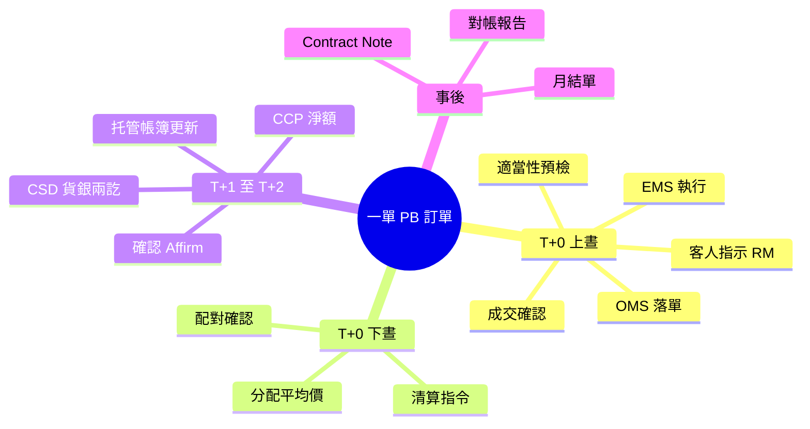
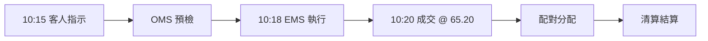

# Module 18: 個案：一單 PB 訂單走全程

Est. study time: 1h
Language: yue
Description: 由客人指示到帳簿更新，一單私人銀行股票訂單走晒成個生命週期——溫習全課程。

## Knowledge Map

---

## Learning Objectives (maps to course CILOs)
- 逐步走一次完整 PB 訂單生命週期
- 由個案反芻各步嘅關鍵控制點同常見出錯位

---

## Real-World Example

星期一 10:15，陳先生叫 RM 買 5,000 股匯豐（0005），市價單，保證金帳戶。RM 確認適當性 → OMS 預檢（購買力夠）→ 交易台 10:18 執行，10:20 全數成交 @ HK$65.20。同日經紀為 8 個客合併落單，陳先生份按平均價分配。T+1 雙方 affirmation；T+2 CCP 淨額後 CSD 貨銀兩訖，托管行帳簿加股票、扣錢。Contract Note 當日或最遲 T+2 寄出，月底對帳一致。

> **Think**: 由指示到成交得 5 分鐘，但生命週期未完——仲欠邊幾步？
>
> *Answer: 配對、分配、清算、結算、對帳。成交只係中段，唔係終點。*

---

## Core Content

### 步驟一：指示同預檢（T+0 上晝）

客人指示 → RM 記錄 → 適當性檢查（保證金帳戶、風險承受匹配）→ OMS 預檢（購買力 = 持倉 × 保證金比例，夠唔夠）→ 過咗先入市場。

> **Predict**: 如果陳先生用現金帳戶，但戶口得 HK$300,000，呢單會點？
>
> *Answer: 現金帳戶要全額 + 費用 ≤ 現金。5,000 × 65.20 ≈ 326,000 > 300,000 → 事前攔截，單落唔到。*

### 步驟二：執行同成交（T+0）

EMS 揀場執行，市價單全數成交。成交報告即時回寫 OMS。同時經紀內部合併多客訂單做平均價。

> **Think**: 平均價對陳先生公唔公平？點解？
>
> *Answer: 公平——全組客人同一單價，成本一致。公平係成本唔係回報。*

### 步驟三：配對同分配（T+0 下晝）

中台收雙方成交數據，對 price/qty/date/ser code 四項。配對一致 → 按平均價分配落各客帳。有 break 就要查原始成交單先修正。

> **Cloze**: "配對四項：{價}、{量}、日期、證券代碼。"
>
> *Answer: 價 / 量*

### 步驟四：清算結算（T+1 至 T+2）

T+1 雙方 affirmation（48 小時內唔確認 → unmatched）。清算所 CCP 淨額結算（保證金 + 風險基金多層保障）。T+2 CSD 貨銀兩訖：錢同時到、股票同時過戶。托管行更新陳先生帳簿。

> **Predict**: 如果 T+2 陳先生戶口現金唔夠交收，會點？
>
> *Answer: 結算失敗 → 保證金追繳 / 強制平倉，仲可能吃 buy-in 損失。Fail 積累成本，要即刻補。*

### 步驟五：事後文件（T+0 至月底）

Contract Note（法律文件，列費用）當日或最遲 T+2 寄出 → 每日對帳（自己 vs 對手 vs 清算所）→ 月結單（持倉 + 費用總覽）。

> **Spot the Mistake**: 同事話：「成交咗就完，出 Contract Note 只係手續。」
>
> 邊度錯？
>
> *Answer: 成交只係中段。配對分配清算結算對帳先係保障客人嘅部分——跳過會導致帳簿錯、結算 fail、客人損失。*

---

## Why This Matters

呢個個案係全課程縮影。客人視角得「買咗」；你視角要有成條鏈。出事嗰陣，你知道去邊個系統邊個台搵答案。

---

## Key Takeaways
- 指示 → 預檢 → 執行 → 配對 → 分配 → 清算 → 結算 → 對帳，八步缺一不可
- 事前攔截（適當性 + 資金）成本最低
- 平均價公平 = 成本一致，唔係回報一致
- T+2 由 trade date 起計；fail 有保證金 / buy-in 後果
- Contract Note 同對帳係法律同控制保障，唔係「手續」

---

## Common Misconception

**「成交咗就等於完成。」**

成交只係中段。未配對、未分配、未清算結算，客人帳簿唔會有貨冇錢。生命週期終點係對帳一致。

---

## Spot the Mistake

客人問：「我星期一買，幾時有貨？」RM 答：「星期一成交，即刻有。」

錯喺邊？

*Answer: HK T+2。星期一買，最早星期三先貨銀兩訖入帳。即刻有係唔識結算週期。*

---

## Feynman Explain

用請食飯解釋：你落單（指示）→ 侍應核對你有冇帶錢（預檢）→ 廚房煮（執行）→ 埋單計數（配對分配）→ 信用卡扣數（清算結算）→ 月結單見到呢餐（對帳）。試下同朋友講一次全條鏈，冇用專業詞。

---

## Reframe

Pause. 判斷：全條鏈邊一步你覺得最易出錯？點解？如果你係中台，會加咩控制？寫低你嘅取捨。

---

## Drill
Take the quiz. MCQs test different angles — recall, application, scenario.

Run: `learn.sh quiz trade-lifecycle 18-case-walkthrough`
