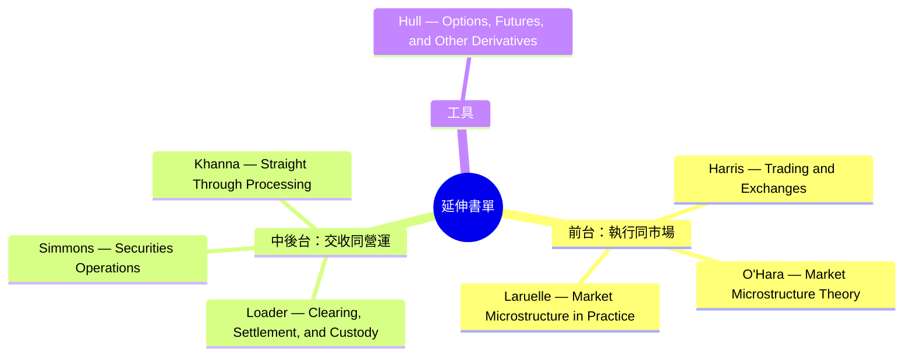
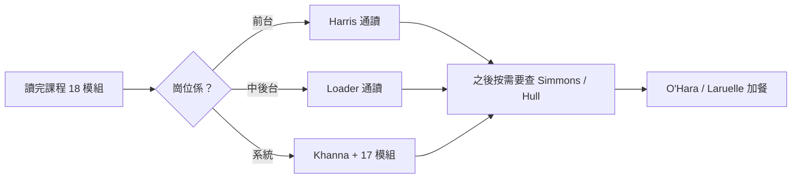

# Module 19: 延伸學習：書單同閱讀路徑

Est. study time: 1h
Language: yue
Description: 完成 18 個模組之後點繼續追落去——七本經過查證嘅參考書，按前中後台分類，配埋閱讀次序同每本書對應邊個模組。

## Knowledge Map

---

## Learning Objectives (maps to course CILOs)
- 揀啱自己岗位嘅書，唔使本本由頭讀到尾
- 將書嘅章節對應返課程模組，建立「課程 ↔ 專業參考」雙軌理解
- 分辨入門、實務、理論三種讀法，定一個可行嘅閱讀計劃

---

## Real-World Example

你啱啱入中台做 settlement，主管話「得閒睇下 Loader 啦」。你買咗本 600 頁嘅書，由第 1 頁讀起，讀咗三章就冇再打開。三個月後有 fail 要處理，你又唔記得書講過咩。

正確做法：先用課程搞掂概念（Module 09–11 已經講咗 CCP、netting、fail），再將 Loader 第 6–10 章（settlement 同 fail 處理）當工具書查。書唔係小說，唔使順序讀。

> **Think**: 點解「由第 1 頁讀起」對工具書係錯嘅方法？
>
> *Answer: 工具書係 reference，按需要查先有效。冇場景配合，讀完都留唔低。課程俾你骨架，書俾你深度。*

---

## Core Content

### 點樣用呢張書單

七本書全部經 Open Library 二次查證，書名、作者、出版社、首版年份清楚列出。分三類讀法：

1. **通讀一本**：揀一本貼近自己岗位嘅，由頭讀一次，建立完整骨架
2. **工具書查閱**：其餘嘅當 reference，出事或者想深入嗰陣先翻對應章節
3. **理論加餐**：O'Hara 嗰本最學術，唔係必讀，想知「點解」先讀

### 第一類：前台——執行同市場結構（對應 Module 03–05）

**1. Trading and Exchanges: Market Microstructure for Practitioners**
作者：Larry Harris
出版社：Oxford University Press，首版 2002
ISBN：9780195144703

市場微觀結構嘅標準參考。講訂單點樣入隊、點樣撮合、點解市價單會漂、做市商點樣提供流動性。你讀完 Module 03–5 之後有基本概念，呢本書幫你知「背後點解」。Harris 曾任 SEC 經濟學家，內容以實務為本。

- 對應模組：03 訂單、05 執行
- 讀法：通讀 Part I–II，即係訂單類型同撮合機制兩部分

**2. Market Microstructure Theory**
作者：Maureen O'Hara
出版社：Blackwell Publishers，首版 1995
ISBN：9780631207610

同一領域嘅理論經典，大量數學模型。講價格點樣形成、資訊點樣反映喺價入面。唔係實務書，係「點解會咁」嘅學術答案。

- 對應模組：05 執行（進階）
- 讀法：唔使順序讀。揀 info asymmetry（資訊不對稱）同 inventory risk（存貨風險）兩章睇就夠

**3. Market Microstructure in Practice**
作者：Sophie Laruelle
出版社：World Scientific，首版 2013
ISBN：9789814566179

Harris 同 O'Hara 之間嘅中間位——比 Harris 新（2013 年，涵蓋暗池、算法交易等現代議題），比 O'Hara 易讀。想知近十年市場結構變化睇呢本。

- 對應模組：05 執行、17 系統（電子化部分）
- 讀法：當補充，讀你覺得好奇嘅章節

### 第二類：中後台——交收、營運、系統（對應 Module 06–11、14、17）

**4. Clearing, Settlement, and Custody**
作者：David Loader
出版社：Butterworth-Heinemann（Elsevier），首版 2002
ISBN：9780750654845

呢個係你哋課程嘅「原著參考」。成個 post-trade 流程——配對、清算、結算、托管、fail 處理——一本书包晒。Loader 係後台營運老手，寫法直接。你讀完 Module 06–11 再睇，會發現課程就係呢本書嘅濃縮版。

- 對應模組：06–11 全部、14 對帳
- 讀法：**最重要一本**。按模組章節對應讀，唔使順序

**5. Securities Operations**
作者：Michael Simmons
出版社：Wiley，首版 2002
ISBN：9780470687843

Back office 營運總覽，涵蓋 confirm、match、allocate、reconcile 嘅操作細節同控制點。Loader 睇流程，Simmons 睇操作——兩本互補。

- 對應模組：07 配對、08 分配、14 對帳、16 異常
- 讀法：工具書。做對帳或者處理 exception 嗰陣查

**6. Straight Through Processing for Financial Services**
作者：Ayesha Khanna
出版社：Academic Press（Elsevier），首版 2007
ISBN：9780124664709

STP（直通式處理）——由落單到交收全自動化點做。你讀完 Module 17 系統地圖之後，呢本書解釋點解要咁樣設計系統、斷鏈（broken interface）點樣形成。

- 對應模組：17 系統、04 落單通道
- 讀法：讀 intro 同 architecture 章節，即係系統架構部分

### 第三類：工具書——衍生工具（對應 Module 12）

**7. Options, Futures, and Other Derivatives**
作者：John C. Hull
出版社：Pearson / Prentice Hall，首版 1989（更新至第 10 版）
ISBN：0131499084（多版本，以最新版為準）

金融衍生工具聖經。期權、期貨、互換全部講清楚。你嘅課程 Module 12 只用一節講衍生品生命週期，想深入知莊家點樣對沖、結算點樣做，睇呢本。

- 對應模組：12 唔同工具
- 讀法：查閱式。你遇見咩合約就讀咩章節，唔使由期貨讀起

### 閱讀次序建議

時間唔夠就一本：前台揀 Harris，中後台揀 Loader。呢兩本最貼課程。

### 點樣驗證一本書係咪真（防止買錯）

查 Open Library（openlibrary.org）或者 Google Books，輸入書名 + 作者。兩個獨立來源都搵到，先好買。課程入面七本書全部經過呢個流程兩次查證。

> **Cloze**: "查證書目用 {Open Library}；兩個獨立來源搵到先好買。中後台首選 {Loader} 嘅 Clearing, Settlement, and Custody。"
>
> *Answer: Open Library / Loader*

---

## Why This Matters

課程俾你骨架同詞彙，書俾你深度同細節。主管問你「fail 點處理」，你答到課程內容係合格；引到 Loader 邊章講咩、市場點解咁做，係突出。兩層理解唔可以互替。

---

## Key Takeaways
- 七本書分三類：通讀、工具查閱、理論加餐
- 中後台首選 Loader；前台首選 Harris；兩本都通讀最穩
- 書係 reference 唔係小說——按模組章節對應查，唔使順序讀
- 驗證書目：Open Library + 第二個來源，兩次先算數
- O'Hara 最理論，唔係必讀；Hull 當工具書查

---

## Common Misconception

**「買齊七本就要讀晒。」**

錯。書單係工具箱，唔係 checklist。一輩子讀一本貼崗位嘅通讀本 + 其餘查閱，已經夠。強求讀晒七本，結果通常係一本都讀唔完。

---

## Spot the Mistake

同事話：「我買咗本 Trading and Exchanges，由第 1 頁開始讀，讀咗兩章瞓著，而家擺喺枱底積塵。」

錯喺邊？

*Answer: 佢未讀課程就直接啃書，而且用順序讀法。正確次序係先讀課程攞骨架，再將 Harris對應返 Module 03–05 嘅概念讀。工具書按需查，唔係小說順序追。*

---

## Feynman Explain

用學煮餸解釋：課程係「食譜」，教識你成道菜點做；書係「廚房百科」，教你點解要用中火、點解魚要反兩次。你唔會為咗學煎蛋由百科第 1 頁讀起——你係遇到問題先查。讀書同煮餸一樣：食譜先行，百科救急。

---

## Reframe

Pause. 判斷：你嘅崗位最貼邊本書？如果得一個月、每日 20 分鐘，你會點安排？寫低你嘅閱讀計劃——明確到「邊本書、邊幾章、幾時睇」先算數。

---

## Drill
Take the quiz. MCQs test different angles — recall, application, scenario.

Run: `learn.sh quiz trade-lifecycle 19-reading-list`
